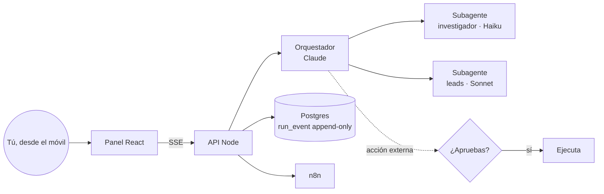

<div align="center">

# 🛰️ Centro de mando

**Un panel con agentes de IA que *hacen* cosas por tu negocio (buscar clientes, preparar correos, vigilar tus automatizaciones), con tu aprobación para todo lo que sale al exterior y el coste medido en cada ejecución.**

[](LICENSE)
[](docs/research/A-agent-sdk.md)
[](web)
[](https://keizactech.com/docs)

🚧 **En desarrollo activo.** La base, la autenticación, el runtime de agentes y la prospección de clientes funcionan; el correo y el envío vienen después.

</div>

---

## ✨ Qué hace

- 💬 **Una caja de chat** donde le pides cosas a un orquestador (Claude) que reparte el trabajo entre subagentes.
- ✋ **Aprobación humana obligatoria:** cualquier acción que salga al exterior se para y espera tu OK, aunque sean horas, y sobrevive a reinicios y redespliegues.
- 💸 **Coste medido** en cada ejecución, con un **tope diario en dólares** que aplica el código, no el modelo.
- 🎯 **Prospección de clientes** desde fuentes públicas (licencias de NYC Open Data) y Google Maps, con teléfonos normalizados y sin duplicados.
- 🔌 **Conectado a n8n** para ver y disparar tus automatizaciones.

## 🧠 Cómo funciona



**Los tres invariantes del diseño** (`api/agent.js`):
1. La fuente de verdad es `run_event`, *append-only*: si el proceso muere a mitad, se reanuda releyendo eventos.
2. La aprobación se comprueba **en el servidor**, nunca confiando en que el prompt "recuerde" pedir permiso.
3. Los topes de coste, iteraciones y presupuesto diario los aplica **el código**.

| Carpeta | Qué hay |
|---|---|
| `api/` | API Node: agentes, aprobaciones, coste, leads, n8n, autenticación |
| `api/sources/` | Fuentes de prospección (NYC Open Data, Google Maps) |
| `web/` | Panel React + Vite, adaptado al móvil |
| `db/migrations/` | Esquema de Postgres numerado |
| `docs/` | Arquitectura, decisiones y **8 informes de investigación** con fuentes |
| `spike/` | Experimentos que probaron que una aprobación diferida sobrevive a reinicios |

## 🚀 Arranque rápido

**Necesitas:** Docker, un Postgres, un proyecto de Firebase (para el login) y una clave de Anthropic.

```bash
git clone https://github.com/RosaritoRD/centro-de-mando.git
cd centro-de-mando
cp .env.example .env            # rellena cada valor (ver abajo)
docker compose up -d --build
# Migraciones, con el rol dueño de la base de datos:
for f in db/migrations/*.sql; do psql "$DB_OWNER_URL" -f "$f"; done
```

| Variable | Para qué |
|---|---|
| `APM_DB_URL` | Conexión a Postgres (rol de la app, no el dueño) |
| `ANTHROPIC_API_KEY` | Los agentes |
| `FIREBASE_PROJECT_ID` · `FIREBASE_CLIENT_EMAIL` · `FIREBASE_PRIVATE_KEY` | Verificar el login |
| `APM_ALLOWED_UIDS` | **Quién puede entrar.** Cualquier otro usuario válido recibe 403 |
| `DAILY_BUDGET_USD` | Freno de mano del gasto diario (por defecto 5) |
| `MAX_CONCURRENT_RUNS` | Cuántos agentes a la vez (~1 GB de RAM cada uno) |
| `N8N_BASE_URL` · `N8N_API_KEY` | (Opcional) tus automatizaciones |

> 🔐 El login acepta un *ID token* de Firebase (`Authorization: Bearer …`) o una cookie de sesión compartida con tu web principal. Siempre comprueba si la cuenta ha sido revocada.

### Tests
```bash
cd api && npm ci && npm test
```

## 📚 La investigación incluida
Antes de escribir código se investigó cada pieza, con fuentes. Es útil aunque no uses el proyecto:

| Informe | Tema |
|---|---|
| [A](docs/research/A-agent-sdk.md) | Claude Agent SDK: sesiones, `canUseTool`, hooks, coste real |
| [B](docs/research/B-arquitecturas.md) | Arquitecturas de "mission control" y orquestadores |
| [C](docs/research/C-ui-chat.md) | UI de chat y *generative UI*, streaming por SSE |
| [D](docs/research/D-scrapers-leads.md) | Fuentes de leads y su análisis legal y de términos de uso |
| [E](docs/research/E-email.md) | Correo: Gmail API vs IMAP, seguridad |
| [F](docs/research/F-n8n-automatizaciones.md) | n8n, scheduler y SSE detrás de un proxy |

## 🤖 Con Claude Code o Codex
Abre la carpeta con `claude` o `codex`. Empieza por `docs/ARCHITECTURE.md` y pídele, por ejemplo: *"Añade un subagente que resuma mis correos sin poder enviarlos"*.

## 💸 Ahorro y mejoras
Ver **[AHORRO-Y-MEJORAS.md](AHORRO-Y-MEJORAS.md)**.

## ⚖️ Uso responsable
Respeta los términos de cada fuente de datos y las leyes de contacto comercial (CAN-SPAM, TCPA). Este proyecto **nunca envía nada sin tu aprobación explícita**; mantenlo así.

## 📚 Más
📖 Guías y más proyectos: **[keizactech.com/docs](https://keizactech.com/docs)**

## 📄 Licencia
MIT — ver [LICENSE](LICENSE).
