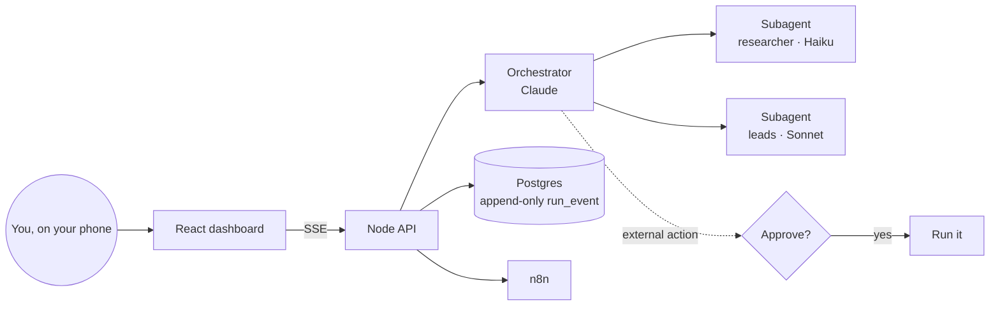

<div align="center">

# 🛰️ Command Center

**A dashboard of AI agents that actually *do* things for your business (find leads, draft emails, watch your automations) — with your approval required for anything that leaves the building, and the cost measured on every run.**

[](LICENSE)
[](docs/research/A-agent-sdk.md)
[](web)
[](https://keizactech.com/docs)

🚧 **Under active development.** The base, authentication, agent runtime and lead prospecting work today; email and sending come next.

</div>

---

## ✨ What it does

- 💬 **One chat box** where you ask an orchestrator (Claude) for work, and it splits the job across subagents.
- ✋ **Mandatory human approval:** any action that reaches the outside world stops and waits for your OK — even for hours — and survives restarts and redeploys.
- 💸 **Cost measured** on every run, with a **daily dollar cap** enforced by the code, not by the model.
- 🎯 **Lead prospecting** from public sources (NYC Open Data licenses) and Google Maps, with normalized phone numbers and no duplicates.
- 🔌 **Connected to n8n** to see and trigger your automations.

> The UI and some internal docs are in Spanish; the code and this README are in English.

## 🧠 How it works



**The three design invariants** (`api/agent.js`):
1. The source of truth is `run_event`, *append-only*: if the process dies halfway, it resumes by replaying events.
2. Approval is checked **on the server** — never by trusting the prompt to "remember" to ask.
3. Cost, iteration and daily-budget caps are enforced **by the code**.

| Folder | What's inside |
|---|---|
| `api/` | Node API: agents, approvals, cost, leads, n8n, auth |
| `api/sources/` | Prospecting sources (NYC Open Data, Google Maps) |
| `web/` | React + Vite dashboard, mobile-friendly |
| `db/migrations/` | Numbered Postgres schema |
| `docs/` | Architecture, decisions and **8 research reports** with sources |
| `spike/` | Experiments proving a deferred approval survives a restart |

## 🚀 Quick start

**You need:** Docker, a Postgres database, a Firebase project (for login) and an Anthropic API key.

```bash
git clone https://github.com/RosaritoRD/centro-de-mando.git
cd centro-de-mando
cp .env.example .env            # fill in every value (see below)
docker compose up -d --build
# Migrations, using the database owner role:
for f in db/migrations/*.sql; do psql "$DB_OWNER_URL" -f "$f"; done
```

| Variable | Purpose |
|---|---|
| `APM_DB_URL` | Postgres connection (the app role, not the owner) |
| `ANTHROPIC_API_KEY` | The agents |
| `FIREBASE_PROJECT_ID` · `FIREBASE_CLIENT_EMAIL` · `FIREBASE_PRIVATE_KEY` | Login verification |
| `APM_ALLOWED_UIDS` | **Who can get in.** Any other valid user gets a 403 |
| `DAILY_BUDGET_USD` | Daily spending handbrake (default 5) |
| `MAX_CONCURRENT_RUNS` | How many agents at once (~1 GB RAM each) |
| `N8N_BASE_URL` · `N8N_API_KEY` | (Optional) your automations |

> 🔐 Login accepts a Firebase *ID token* (`Authorization: Bearer …`) or a session cookie shared with your main site. It always checks whether the account has been revoked.

### Tests
```bash
cd api && npm ci && npm test
```

## 📚 The research included
Every piece was researched, with sources, before writing code. It's useful even if you never run the project (reports are in Spanish):

| Report | Topic |
|---|---|
| [A](docs/research/A-agent-sdk.md) | Claude Agent SDK: sessions, `canUseTool`, hooks, real cost |
| [B](docs/research/B-arquitecturas.md) | "Mission control" architectures and orchestrators |
| [C](docs/research/C-ui-chat.md) | Chat UI and *generative UI*, SSE streaming |
| [D](docs/research/D-scrapers-leads.md) | Lead sources and their legal / terms-of-service analysis |
| [E](docs/research/E-email.md) | Email: Gmail API vs IMAP, security |
| [F](docs/research/F-n8n-automatizaciones.md) | n8n, scheduler and SSE behind a proxy |

## 🤖 With Claude Code or Codex
Open the folder with `claude` or `codex`. Start from `docs/ARCHITECTURE.md` and ask, for example: *"Add a subagent that summarizes my email without being able to send any."*

## 💸 Savings and tips
See **[SAVINGS-AND-TIPS.md](SAVINGS-AND-TIPS.md)**.

## 🤝 Contributing
Issues and PRs are welcome — look for the [`good first issue`](https://github.com/RosaritoRD/centro-de-mando/labels/good%20first%20issue) label and read [CONTRIBUTING.md](CONTRIBUTING.md). Questions and ideas go in [Discussions](https://github.com/RosaritoRD/centro-de-mando/discussions).

## ⚖️ Responsible use
Respect each data source's terms and commercial-contact laws (CAN-SPAM, TCPA). This project **never sends anything without your explicit approval** — keep it that way.

## 📚 More
📖 Guides and more projects: **[keizactech.com/docs](https://keizactech.com/docs)**

## 📄 License
MIT — see [LICENSE](LICENSE).
