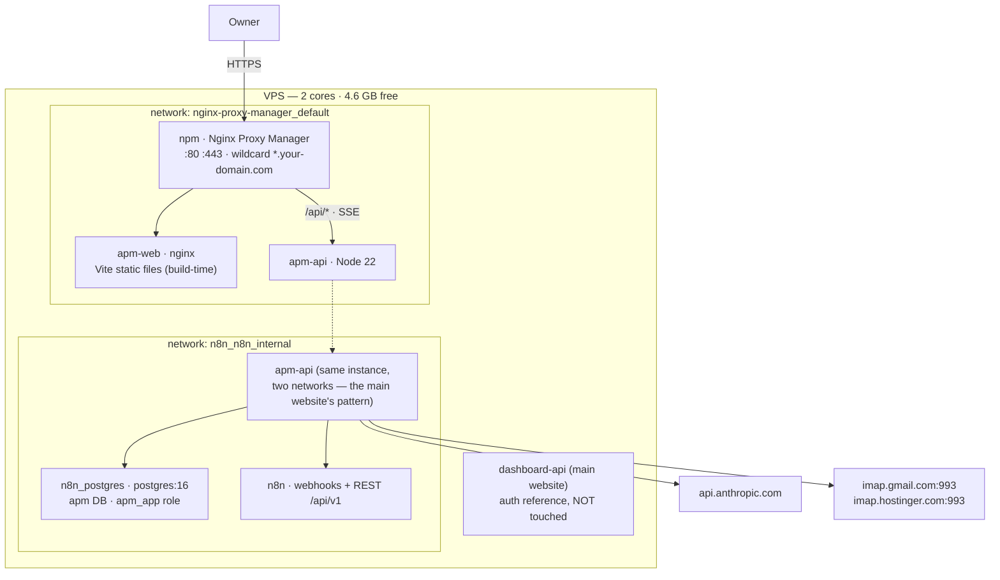
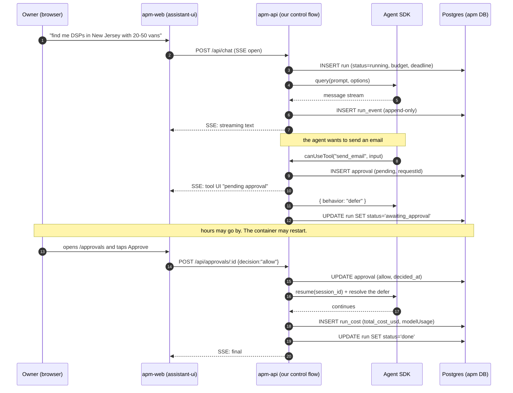

# ARCHITECTURE — APM

**Date:** August 2, 2026 · **Status:** proposal for **GATE 0**.
Decisions and reasons in `RESEARCH.md`; technical detail in `research/A..H`.
This document defines **what gets built in Phase 1 and how the rest fits in**.

---

## 1. Container view

Two new containers. No new Postgres, no new Redis, no new proxy.



**Deployment rules (inherited from the main website, no innovation):**

- `apm-api` joins **both networks** and **publishes no ports**.
- `apm-web` only serves static files. **There's no Node process in production** — Vite
  builds inside the `Dockerfile` (that's why React costs no RAM; see `RESEARCH.md` §2,
  decision 1).
- The NPM Proxy Host for `apm.your-domain.com` uses the **existing wildcard certificate**:
  zero manual DNS steps.
- The streaming route needs the anti-buffering config from report F §6 (ready to paste).

---

## 2. The flow that defines the product: a run with approval

Everything else is plumbing. This is APM.



**This diagram's three invariants:**

1. **The source of truth is `run_event`, append-only.** Rebuild = replay events.
   If the process dies at step 9, step 12 still works.
2. **Approval is checked on the server**, against the `approval` row. We never trust
   the prompt to "remember" to ask for permission.
3. **The caps (cost, iterations, deadline) are enforced by our code**, not by the model.

⚠️ **This flow depended on spike #1**: that `SessionStore` + `defer` survive a restart
(risk 1 in `RESEARCH.md`). If they hadn't, plan B was not to pause the agent: end the run,
save the context, and on approval launch a new run that continues. Worse, but it works.
(Resolved: they survive — see SPIKE-01 and SPIKE-02. Also note that `defer` lives in a
PreToolUse hook, not in `canUseTool`: see the correction at the top of `api/agent.js`.)

---

## 3. Data model — migration 001

House conventions: **TEXT not VARCHAR, TIMESTAMPTZ, no foreign keys, soft delete,
`uuid_generate_v4()`, partial indexes, explicit GRANTs**. Applied with the **owner** role,
not the application role.

```sql
-- APM
-- Migration 001: core of runs, approvals and cost.
--
-- Apply with:
--   docker exec -i n8n_postgres psql -U n8n -d apm < db/migrations/001_core.sql
--
-- Conventions: TEXT, TIMESTAMPTZ, soft delete, no FKs, GRANTs to apm_app.
-- Ids are UUIDs because they travel in URLs (/api/runs/:id), and with
-- sequential ids you could enumerate the history by counting up.

CREATE EXTENSION IF NOT EXISTS "uuid-ossp";

-- ── Runs ───────────────────────────────────────────────────────────
-- session_id is the Agent SDK's: without it nothing can resume (report A §5).
-- budget_usd and max_iterations are NOT decoration: they're the handbrake on the
-- 15x multi-agent multiplier. The code enforces them, not the prompt.
CREATE TABLE IF NOT EXISTS run (
  id             UUID PRIMARY KEY DEFAULT uuid_generate_v4(),
  area           TEXT NOT NULL DEFAULT 'general',   -- marketing|ventas|infra|finanzas|general (sales|infra|finance)
  title          TEXT,
  status         TEXT NOT NULL DEFAULT 'queued'
                 CHECK (status IN ('queued','running','awaiting_approval',
                                   'done','failed','cancelled','interrupted')),
  session_id     TEXT,
  model          TEXT NOT NULL,
  budget_usd     NUMERIC(10,4) NOT NULL DEFAULT 1.0,
  max_iterations INTEGER NOT NULL DEFAULT 40,
  deadline_at    TIMESTAMPTZ,
  started_at     TIMESTAMPTZ,
  ended_at       TIMESTAMPTZ,
  error          TEXT,
  created_at     TIMESTAMPTZ NOT NULL DEFAULT now(),
  updated_at     TIMESTAMPTZ NOT NULL DEFAULT now()
);

-- Partial index: the hot query is "what's still alive?", never the whole history.
CREATE INDEX IF NOT EXISTS run_live_idx ON run (created_at DESC)
  WHERE status IN ('queued','running','awaiting_approval');

-- ── Event log — APPEND ONLY ────────────────────────────────────────
-- This table is the source of truth (factor 12). Never UPDATEd.
-- payload is JSONB because each event type's shape will change; a rigid
-- schema would force a migration every time the SDK adds a field.
CREATE TABLE IF NOT EXISTS run_event (
  id         BIGINT GENERATED ALWAYS AS IDENTITY PRIMARY KEY,
  run_id     UUID NOT NULL,
  seq        INTEGER NOT NULL,
  kind       TEXT NOT NULL,   -- user|assistant|tool_use|tool_result|thinking|error|system
  payload    JSONB NOT NULL,
  created_at TIMESTAMPTZ NOT NULL DEFAULT now()
);
CREATE UNIQUE INDEX IF NOT EXISTS run_event_seq_idx ON run_event (run_id, seq);

-- ── Cost ───────────────────────────────────────────────────────────
-- Names aligned with the OpenTelemetry GenAI semconv: the day we want to
-- export to a collector it's a SELECT, not a migration.
-- ⚠️ cost_usd comes from the SDK's total_cost_usd, NEVER from usage: usage
-- EXCLUDES subagent tokens (correction to report A).
CREATE TABLE IF NOT EXISTS run_cost (
  id                          BIGINT GENERATED ALWAYS AS IDENTITY PRIMARY KEY,
  run_id                      UUID NOT NULL,
  model                       TEXT NOT NULL,
  operation_name              TEXT NOT NULL DEFAULT 'invoke_agent',
  input_tokens                BIGINT NOT NULL DEFAULT 0,
  output_tokens               BIGINT NOT NULL DEFAULT 0,
  cache_read_input_tokens     BIGINT NOT NULL DEFAULT 0,
  cache_creation_input_tokens BIGINT NOT NULL DEFAULT 0,
  cost_usd                    NUMERIC(12,6) NOT NULL DEFAULT 0,
  created_at                  TIMESTAMPTZ NOT NULL DEFAULT now()
);
CREATE INDEX IF NOT EXISTS run_cost_day_idx ON run_cost (created_at DESC);

-- ── Prices ─────────────────────────────────────────────────────────
-- In a table and NOT in code: the Sonnet 5 promo ends on 31-Aug-2026, and
-- if the price is hard-coded, the dashboard starts lying that day, silently.
CREATE TABLE IF NOT EXISTS model_pricing (
  model            TEXT PRIMARY KEY,
  input_per_mtok   NUMERIC(10,4) NOT NULL,
  output_per_mtok  NUMERIC(10,4) NOT NULL,
  cache_read_mult  NUMERIC(6,4) NOT NULL DEFAULT 0.1,
  cache_write_mult NUMERIC(6,4) NOT NULL DEFAULT 1.25,
  note             TEXT,
  updated_at       TIMESTAMPTZ NOT NULL DEFAULT now()
);

INSERT INTO model_pricing (model, input_per_mtok, output_per_mtok, note) VALUES
  ('claude-opus-5',    5.00, 25.00, 'orchestrator'),
  ('claude-sonnet-5',  2.00, 10.00, 'PROMO until 2026-08-31; then 3.00/15.00'),
  ('claude-haiku-4-5', 1.00,  5.00, 'classification and triage')
ON CONFLICT (model) DO NOTHING;

-- ── Approvals ──────────────────────────────────────────────────────
-- request_id is the SDK's canUseTool/defer id: it's the key to resume.
-- No TTL in the DB on purpose: the SDK doesn't expire permission promises
-- (report A §13), so expiring here would leave the agent hanging. What we
-- do is CANCEL the run, not silently expire the approval.
CREATE TABLE IF NOT EXISTS approval (
  id          UUID PRIMARY KEY DEFAULT uuid_generate_v4(),
  run_id      UUID NOT NULL,
  request_id  TEXT NOT NULL,
  tool_name   TEXT NOT NULL,
  tool_input  JSONB NOT NULL,
  summary     TEXT,                       -- what's about to happen, in plain words, for the phone
  decision    TEXT CHECK (decision IN ('allow','deny')),
  deny_reason TEXT,
  decided_at  TIMESTAMPTZ,
  created_at  TIMESTAMPTZ NOT NULL DEFAULT now()
);
CREATE INDEX IF NOT EXISTS approval_pending_idx ON approval (created_at)
  WHERE decision IS NULL;
CREATE UNIQUE INDEX IF NOT EXISTS approval_request_idx ON approval (run_id, request_id);

-- ── Daily budget ───────────────────────────────────────────────────
-- One row per day. When spent_usd >= limit_usd, the orchestrator refuses
-- to launch subagents. With the 15x multiplier this isn't a metric: it's
-- the handbrake.
CREATE TABLE IF NOT EXISTS budget_day (
  day        DATE PRIMARY KEY,
  limit_usd  NUMERIC(10,2) NOT NULL DEFAULT 5.00,
  spent_usd  NUMERIC(12,6) NOT NULL DEFAULT 0,
  updated_at TIMESTAMPTZ NOT NULL DEFAULT now()
);

-- ── Permissions ────────────────────────────────────────────────────
GRANT USAGE ON SCHEMA public TO apm_app;
GRANT SELECT, INSERT, UPDATE ON ALL TABLES IN SCHEMA public TO apm_app;
GRANT USAGE, SELECT ON ALL SEQUENCES IN SCHEMA public TO apm_app;
-- ── Permissions ────────────────────────────────────────────────────
GRANT USAGE ON SCHEMA public TO apm_app;
GRANT SELECT, INSERT, UPDATE ON ALL TABLES IN SCHEMA public TO apm_app;
GRANT USAGE, SELECT ON ALL SEQUENCES IN SCHEMA public TO apm_app;
-- DELETE is deliberately NOT granted: in APM we archive, we don't delete.
```

**Tables for later phases** (not in 001; listed so the model makes sense):

| Phase | Tables | Report |
|---|---|---|
| 3 | `lead` (with `source`, `source_url`, `fetched_at`, `license`), `suppression` | D |
| 4 | `message` (unified inbox, read-only), `outbox` (drafts pending approval) | E |
| 5 | `area`, `website`, `health_check` | — |
| 6 | `schedule` (managed by pg-boss) + `automation_run` | F |

---

## 4. API contracts

Everything under `/api`, authenticated with the `__session` cookie. Errors have the shape
`{ error: { code, message } }`.

### 4.1 Chat and runs

⚠️ **CORRECTION TO WHAT THIS TABLE USED TO SAY.** It drew a `POST /api/chat` that answered
with SSE and served both to start *and* to continue. That's not what got built, nor what's
best: starting is a short POST that returns an id, and following the run is a GET on the
stream. Separating them is what lets you close the browser and come back hours later — a
POST that answers with SSE ties the conversation to the request that created it.

| Method | Route | What it does |
|---|---|---|
| `POST` | `/api/runs` | Starts a run. Body: `{ prompt, model?, area?, budgetUsd?, title?, location? }` → `{ id, status, model }` |
| `POST` | `/api/runs/:id/messages` | Another message in an existing conversation. Resumes by `session_id`. `409` if it's still working or no session is left |
| `GET` | `/api/runs/:id/stream` | **SSE.** Replays `run_event` from `Last-Event-ID`/`?desde=` and then emits live |
| `GET` | `/api/runs` | Latest runs (`?limit=`) + `vivas`. Each carries `continuable` and `buscaEn` |
| `GET` | `/api/runs/:id` | Header, events and approvals — the whole thread to open an old chat |

`continuable` is decided by the server, not the browser: it's the one that knows that
without a `session_id` there's nothing to resume, so the keep-writing button never appears
only to vanish when tapped.

### 4.2 Approvals

| Method | Route | What it does |
|---|---|---|
| `GET` | `/api/approvals` | Pending ones (`decision IS NULL`), oldest first |
| `POST` | `/api/approvals/:id` | `{ decision: "allow"\|"deny", denyReason? }` → resumes the run |

**Mandatory idempotency by `request_id`** ✅ (the SDK docs require it under
`reinitialize()`): tapping Approve twice on a phone must not run the action twice.

### 4.3 Cost and budget

| Method | Route | What it does |
|---|---|---|
| `GET` | `/api/cost/summary?days=30` | Daily series: tokens, dollars, number of runs |
| `GET` | `/api/budget` | Today's limit and spend |
| `PUT` | `/api/budget` | `{ limitUsd }` |

### 4.4 Health

| Method | Route | What it does |
|---|---|---|
| `GET` | `/api/health` | `{ ok, db, sdk, version }` — for the host watchdog |

### 4.5 Location (migration 004)

Two places, not one: `base` is where you ask from (time zone, market) and `target` is where
to search for leads. You live in one place and sell in another; a single field forces you to
lose one of the two.

| Method | Route | What it does |
|---|---|---|
| `GET` | `/api/location` | Saved default + already-used `ciudades`, for the dropdown |
| `PUT` | `/api/location` | `{ base:{city,country}, target:{city,country} }`. The country is alpha-2; anything else is dropped |

Rules that aren't about style:

- **An empty target inherits the base, never the other way round.** "Find leads" without
  saying where means "where I am"; being in New York doesn't mean selling there.
- **It's frozen on the `run` row**, not just in the global setting. Opening a month-old chat
  must say which area it ran with, and a global setting would silently rewrite the past.
- It's stored on the server, not in `localStorage`: you sign in from your phone and from your
  desktop, and otherwise the agent searches somewhere different depending on the device.

---

## 5. Streaming protocol

`assistant-ui` consumes the **AI SDK UI Message Stream**, which our backend emits by hand
(report C §0). The minimum contract per SSE event:

| Type | When | Content |
|---|---|---|
| `text-delta` | The agent writes | text fragment |
| `tool-call` | It calls a tool | `toolName`, `args` — triggers the tool UI |
| `tool-result` | The tool answers | result, already sanitized |
| `approval-required` | `canUseTool` defers | `approvalId`, `summary` → card with Approve/Reject |
| `cost` | End of turn | `costUsd`, accumulated tokens → on-screen counter |
| `error` | Any failure | readable message; **never** the stack trace |
| `finish` | End | `runId`, `status` |

⚠️ Before fixing this contract, **log a real `AssistantChatTransport` request** (open risk in
report C §9): it puts extra fields in the body compared to `DefaultChatTransport`.
(In the end the UI was built with plain React + EventSource and one named SSE event per
type: see `web/src/Chat.jsx`.)

**Without NPM's anti-buffering config (report F §6), streaming shows up as one block of text
at the end.** It's not an app bug: it's the proxy. It's on the Phase 1 checklist.

---

## 6. Authentication

Zero new login screens. What already exists is reused ✅ (report G.6):

1. The browser sends the **`__session`** cookie (Domain `.your-domain.com`, 14 days) to
   `apm.your-domain.com` automatically.
2. `apm-api` verifies it with `firebase-admin` from the **same Firebase project**, using
   `verifySessionCookie(cookie, true)` — **always checking revocation**.
3. No valid cookie → redirect to `signin.your-domain.com`.

⚠️ **The trap that already cost a bug**: if the page doesn't exchange the cookie for a custom
token on startup, it bounces to `/login` in a loop. **`restoreSession` is implemented on day
one**, not "when it causes trouble".

**Authorization:** a single user. The rule is a **UID allowlist** in `.env`
(`APM_ALLOWED_UIDS`). Any other valid Firebase UID gets a **403**, not an empty 200: another
account on the same Firebase project getting into the command center would be the most
expensive failure possible.

---

## 7. Deployment

```
/opt/centro-de-mando
├── docker-compose.yml        # apm-web + apm-api, proxy + n8n_internal networks
├── .env / .env.example       # secrets ONLY here, never in the repo
├── api/                      # Node: routes, agents, tools
│   ├── server.js
│   ├── agent.js  runs.js     # agent runtime and its routes
│   ├── db.js
│   └── *.test.js             # node --test
├── web/                      # Vite + React
│   ├── src/  index.html  vite.config.js
│   └── Dockerfile            # multi-stage build → nginx with the static files
├── db/migrations/            # 001_core.sql, ...
└── docs/                     # this document and the reports
```

**Phase 1 startup order** (each step verifiable on its own):

1. `CREATE DATABASE apm` + `apm_app` role (as `n8n`, the owner).
2. Migration 001 applied and checked with `\dt`.
3. `apm-api` starts and `/api/health` answers `{ok:true}` **from inside** the Docker network.
4. NPM Proxy Host → wildcard cert → `https://apm.your-domain.com/api/health` answers.
5. Dashboard shell with Spectra tokens, light theme, tested **at 390 px**.
6. SSO: sign in from `signin.your-domain.com` and **not** bounce.

**Backups:** the `apm` DB goes into the server's backup script (encrypted, off-site) the same
day it's created. A database without backups isn't in production, it's a test.

---

## 8. Guards that go into the code from commit 1

They're not good intentions; they're constants and tests:

| Guard | Where | Why |
|---|---|---|
| `MAX_CONCURRENT_RUNS=2` | config + queue | ~1 GiB per agent out of 4.6 GB free (`RESEARCH.md` §2) |
| `budget_usd` and `deadline_at` per run | `run` table + loop | The model doesn't limit itself |
| Daily budget in dollars | `budget_day` | The 15× multi-agent multiplier |
| Requeue on startup | `run` in `running` with no worker → `interrupted` | The cheap version of a "rainbow deploy" |
| Idempotent approval by `request_id` | `/api/approvals/:id` | Double tap on a phone |
| UID allowlist | auth middleware | A single user, for real |
| `run_event` is never updated | guard test | The day someone runs an UPDATE, the state stops being rebuildable |
| Prices in a table, not in code | `model_pricing` | The Sonnet promo ends on 31-Aug-2026 |

---

## 9. What this document does NOT decide

Honesty about the edges, so nobody discovers them halfway through Phase 2:

1. **The exact way to resume after an approval** — it depended on the `SessionStore` +
   `defer` spike (risk 1). §2 describes the happy path; plan B is written down.
2. **The exact SSE contract** — a real `AssistantChatTransport` request had to be logged (§5).
3. **Tables for Phases 3-6** — sketched, not designed. Each phase opens its own migration.
4. **Multi-tenant** — out of scope. If APM were ever sold, the isolation (`CLAUDE_CONFIG_DIR`
   and `cwd` per tenant, `CLAUDE_CODE_DISABLE_AUTO_MEMORY=1`) is documented in report A §13,
   but **it isn't built now**.
