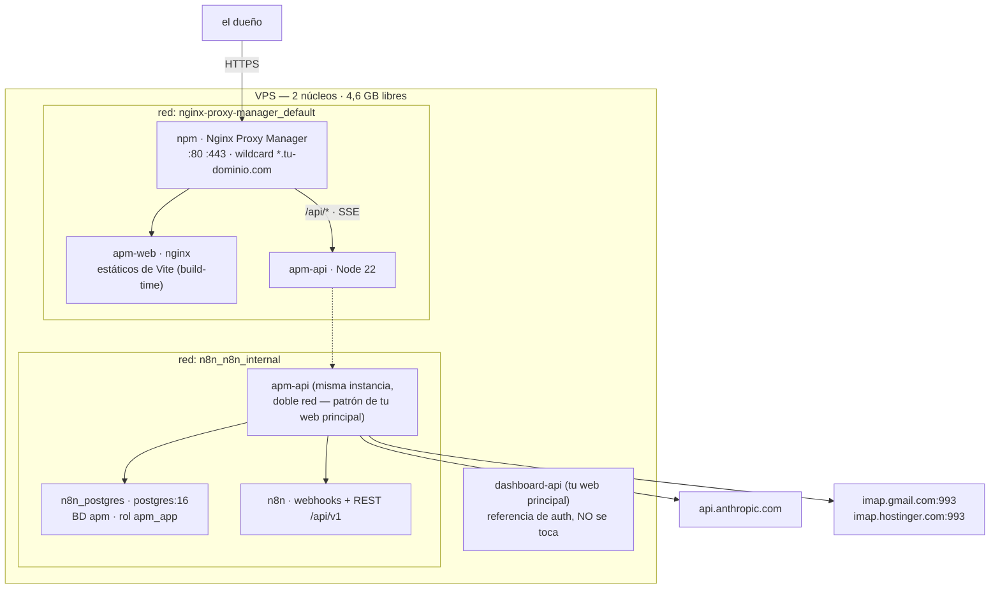
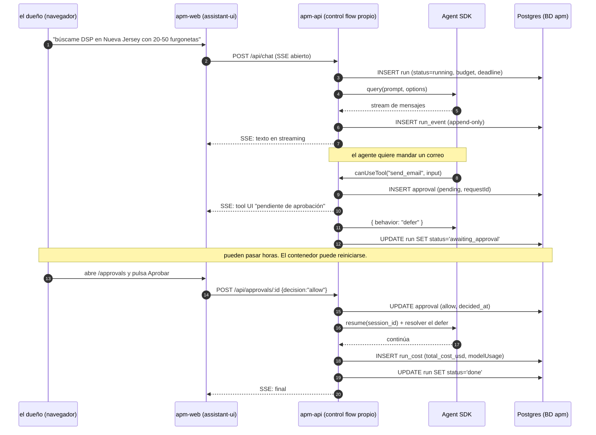

# ARCHITECTURE — APM

**Fecha:** 2 de agosto de 2026 · **Estado:** propuesta para el **GATE 0**.
Decisiones y motivos en `RESEARCH.md`; detalle técnico en `research/A..H`.
Este documento define **qué se construye en la Fase 1 y cómo encaja lo demás**.

---

## 1. Vista de contenedores

Dos contenedores nuevos. Ni Postgres nuevo, ni Redis nuevo, ni proxy nuevo.



**Reglas de despliegue (heredadas de `tu web principal`, no se innova):**

- `apm-api` se une a **las dos redes** y **no publica puertos**.
- `apm-web` solo sirve estáticos. **No hay proceso Node en producción** — Vite compila
  dentro del `Dockerfile` (por eso React no cuesta RAM; ver `RESEARCH.md` §2, decisión 1).
- El Proxy Host de `apm.tu-dominio.com` en NPM usa el **certificado wildcard existente**:
  cero pasos manuales de DNS.
- La ruta de streaming necesita la config anti-buffering del informe F §6 (lista para pegar).

---

## 2. El flujo que define el producto: ejecución con aprobación

Todo lo demás es plomería. Esto es APM.



**Los tres invariantes de este diagrama:**

1. **El estado de verdad es `run_event`, append-only.** Reconstruir = releer eventos.
   Si el proceso muere en el paso 9, el paso 12 sigue funcionando.
2. **La aprobación se verifica en el servidor**, contra la fila de `approval`. Nunca se
   confía en que el prompt "recuerde" pedir permiso.
3. **Los topes (coste, iteraciones, deadline) los aplica nuestro código**, no el modelo.

⚠️ **Este flujo depende del spike nº1**: que `SessionStore` + `defer` sobrevivan a un
reinicio (riesgo 1 de `RESEARCH.md`). Si no sobreviven, el plan B es no pausar al agente:
se termina la ejecución, se guarda el contexto, y al aprobar se lanza una ejecución nueva
que continúa. Peor, pero funciona.

---

## 3. Modelo de datos — migración 001

Convenciones de la casa (`rules/database`, y lo que ya hace `tu web principal`): **TEXT no VARCHAR,
TIMESTAMPTZ, sin claves foráneas, soft delete, `uuid_generate_v4()`, índices parciales,
GRANTs explícitos**. Se aplica con el rol **dueño**, no con el de la aplicación
(memoria `aplicar-migraciones`).

```sql
-- tu empresa — APM
-- Migración 001: núcleo de ejecuciones, aprobaciones y coste.
--
-- Se aplica con:
--   docker exec -i n8n_postgres psql -U n8n -d apm < db/migrations/001_core.sql
--
-- Convenciones: TEXT, TIMESTAMPTZ, soft delete, sin FK, GRANTs a apm_app.
-- Los ids son UUID porque viajan en URLs (/api/runs/:id) y con ids
-- secuenciales se enumera el historial contando hacia arriba.

CREATE EXTENSION IF NOT EXISTS "uuid-ossp";

-- ── Ejecuciones ────────────────────────────────────────────────────
-- session_id es el del Agent SDK: sin él no se puede reanudar (informe A §5).
-- budget_usd y max_iterations NO son adorno: son el freno de mano del
-- multiplicador 15x del multi-agente. Los aplica el código, no el prompt.
CREATE TABLE IF NOT EXISTS run (
  id             UUID PRIMARY KEY DEFAULT uuid_generate_v4(),
  area           TEXT NOT NULL DEFAULT 'general',   -- marketing|ventas|infra|finanzas|general
  title          TEXT,
  status         TEXT NOT NULL DEFAULT 'queued'
                 CHECK (status IN ('queued','running','awaiting_approval',
                                   'done','failed','cancelled','interrupted')),
  session_id     TEXT,
  model          TEXT NOT NULL,
  budget_usd     NUMERIC(10,4) NOT NULL DEFAULT 1.0,
  max_iterations INTEGER NOT NULL DEFAULT 40,
  deadline_at    TIMESTAMPTZ,
  started_at     TIMESTAMPTZ,
  ended_at       TIMESTAMPTZ,
  error          TEXT,
  created_at     TIMESTAMPTZ NOT NULL DEFAULT now(),
  updated_at     TIMESTAMPTZ NOT NULL DEFAULT now()
);

-- Índice parcial: la consulta caliente es "¿qué sigue vivo?", nunca el historial entero.
CREATE INDEX IF NOT EXISTS run_live_idx ON run (created_at DESC)
  WHERE status IN ('queued','running','awaiting_approval');

-- ── Log de eventos — APPEND ONLY ───────────────────────────────────
-- Esta tabla es el estado de verdad (factor 12). Nunca se hace UPDATE.
-- payload es JSONB porque la forma de cada tipo de evento cambiará; el
-- esquema rígido nos obligaría a migrar cada vez que el SDK añada un campo.
CREATE TABLE IF NOT EXISTS run_event (
  id         BIGINT GENERATED ALWAYS AS IDENTITY PRIMARY KEY,
  run_id     UUID NOT NULL,
  seq        INTEGER NOT NULL,
  kind       TEXT NOT NULL,   -- user|assistant|tool_use|tool_result|thinking|error|system
  payload    JSONB NOT NULL,
  created_at TIMESTAMPTZ NOT NULL DEFAULT now()
);
CREATE UNIQUE INDEX IF NOT EXISTS run_event_seq_idx ON run_event (run_id, seq);

-- ── Coste ──────────────────────────────────────────────────────────
-- Nombres alineados con la semconv GenAI de OpenTelemetry: el día que
-- queramos exportar a un colector es un SELECT, no una migración.
-- ⚠️ cost_usd viene de total_cost_usd del SDK, NUNCA de usage: usage
-- EXCLUYE los tokens de los subagentes (corrección del informe A).
CREATE TABLE IF NOT EXISTS run_cost (
  id                          BIGINT GENERATED ALWAYS AS IDENTITY PRIMARY KEY,
  run_id                      UUID NOT NULL,
  model                       TEXT NOT NULL,
  operation_name              TEXT NOT NULL DEFAULT 'invoke_agent',
  input_tokens                BIGINT NOT NULL DEFAULT 0,
  output_tokens               BIGINT NOT NULL DEFAULT 0,
  cache_read_input_tokens     BIGINT NOT NULL DEFAULT 0,
  cache_creation_input_tokens BIGINT NOT NULL DEFAULT 0,
  cost_usd                    NUMERIC(12,6) NOT NULL DEFAULT 0,
  created_at                  TIMESTAMPTZ NOT NULL DEFAULT now()
);
CREATE INDEX IF NOT EXISTS run_cost_day_idx ON run_cost (created_at DESC);

-- ── Precios ────────────────────────────────────────────────────────
-- En tabla y NO en el código: la promo de Sonnet 5 vence el 31-ago-2026 y
-- si el precio está hardcodeado, el panel empieza a mentir ese día en silencio.
CREATE TABLE IF NOT EXISTS model_pricing (
  model            TEXT PRIMARY KEY,
  input_per_mtok   NUMERIC(10,4) NOT NULL,
  output_per_mtok  NUMERIC(10,4) NOT NULL,
  cache_read_mult  NUMERIC(6,4) NOT NULL DEFAULT 0.1,
  cache_write_mult NUMERIC(6,4) NOT NULL DEFAULT 1.25,
  note             TEXT,
  updated_at       TIMESTAMPTZ NOT NULL DEFAULT now()
);

INSERT INTO model_pricing (model, input_per_mtok, output_per_mtok, note) VALUES
  ('claude-opus-5',    5.00, 25.00, 'orquestador'),
  ('claude-sonnet-5',  2.00, 10.00, 'PROMO hasta 2026-08-31; luego 3.00/15.00'),
  ('claude-haiku-4-5', 1.00,  5.00, 'clasificacion y triaje')
ON CONFLICT (model) DO NOTHING;

-- ── Aprobaciones ───────────────────────────────────────────────────
-- request_id es el del canUseTool/defer del SDK: es la llave para reanudar.
-- Sin TTL en la BD a propósito: el SDK no expira las promesas de permiso
-- (informe A §13), así que expirar aquí dejaría al agente colgado. Lo que
-- se hace es CANCELAR la ejecución, no caducar la aprobación en silencio.
CREATE TABLE IF NOT EXISTS approval (
  id          UUID PRIMARY KEY DEFAULT uuid_generate_v4(),
  run_id      UUID NOT NULL,
  request_id  TEXT NOT NULL,
  tool_name   TEXT NOT NULL,
  tool_input  JSONB NOT NULL,
  summary     TEXT,                       -- qué va a pasar, en cristiano, para el móvil
  decision    TEXT CHECK (decision IN ('allow','deny')),
  deny_reason TEXT,
  decided_at  TIMESTAMPTZ,
  created_at  TIMESTAMPTZ NOT NULL DEFAULT now()
);
CREATE INDEX IF NOT EXISTS approval_pending_idx ON approval (created_at)
  WHERE decision IS NULL;
CREATE UNIQUE INDEX IF NOT EXISTS approval_request_idx ON approval (run_id, request_id);

-- ── Presupuesto diario ─────────────────────────────────────────────
-- Una fila por día. Cuando spent_usd >= limit_usd, el orquestador se niega
-- a lanzar subagentes. Con el multiplicador 15x esto no es una metrica: es
-- el freno de mano.
CREATE TABLE IF NOT EXISTS budget_day (
  day        DATE PRIMARY KEY,
  limit_usd  NUMERIC(10,2) NOT NULL DEFAULT 5.00,
  spent_usd  NUMERIC(12,6) NOT NULL DEFAULT 0,
  updated_at TIMESTAMPTZ NOT NULL DEFAULT now()
);

-- ── Permisos ───────────────────────────────────────────────────────
GRANT USAGE ON SCHEMA public TO apm_app;
GRANT SELECT, INSERT, UPDATE ON ALL TABLES IN SCHEMA public TO apm_app;
GRANT USAGE, SELECT ON ALL SEQUENCES IN SCHEMA public TO apm_app;
-- DELETE deliberadamente NO se concede: en APM se archiva, no se borra.
```

**Tablas de fases posteriores** (no van en la 001, se listan para que el modelo se entienda):

| Fase | Tablas | Informe |
|---|---|---|
| 3 | `lead` (con `source`, `source_url`, `fetched_at`, `license`), `suppression` | D |
| 4 | `message` (bandeja unificada, solo lectura), `outbox` (borradores por aprobar) | E |
| 5 | `area`, `website`, `health_check` | — |
| 6 | `schedule` (lo gestiona pg-boss) + `automation_run` | F |

---

## 4. Contratos de API

Todo bajo `/api`, autenticado con la cookie `__session`. Errores con la forma
`{ error: { code, message } }`.

### 4.1 Chat y ejecuciones

⚠️ **CORRECCIÓN A LO QUE DECÍA ESTA TABLA.** Aquí se dibujaba un `POST /api/chat`
que respondía SSE y servía para arrancar *y* continuar. No es lo que se
construyó ni lo que conviene: arrancar es un POST corto que devuelve un id, y
seguir la ejecución es un GET al stream. Separarlos es lo que permite cerrar el
navegador y volver horas después — un POST que responde SSE ata la
conversación a la petición que la creó.

| Método | Ruta | Qué hace |
|---|---|---|
| `POST` | `/api/runs` | Arranca una ejecución. Body: `{ prompt, model?, area?, budgetUsd?, title?, location? }` → `{ id, status, model }` |
| `POST` | `/api/runs/:id/messages` | Otro mensaje en una conversación ya existente. Reanuda por `session_id`. `409` si sigue trabajando o si no quedó sesión |
| `GET` | `/api/runs/:id/stream` | **SSE.** Reproduce `run_event` desde `Last-Event-ID`/`?desde=` y luego emite en vivo |
| `GET` | `/api/runs` | Últimas ejecuciones (`?limit=`) + `vivas`. Cada una trae `continuable` y `buscaEn` |
| `GET` | `/api/runs/:id` | Cabecera, eventos y aprobaciones — el hilo entero para abrir un chat viejo |

`continuable` lo decide el servidor y no el navegador: es quien sabe que sin
`session_id` no hay nada que reanudar, y así el botón de seguir escribiendo no
aparece para desaparecer al pulsarlo.

### 4.2 Aprobaciones

| Método | Ruta | Qué hace |
|---|---|---|
| `GET` | `/api/approvals` | Pendientes (`decision IS NULL`), orden por antigüedad |
| `POST` | `/api/approvals/:id` | `{ decision: "allow"\|"deny", denyReason? }` → reanuda la ejecución |

**Idempotencia obligatoria por `request_id`** ✅ (la doc del SDK lo exige bajo
`reinitialize()`): pulsar Aprobar dos veces desde el móvil no debe ejecutar la acción dos veces.

### 4.3 Coste y presupuesto

| Método | Ruta | Qué hace |
|---|---|---|
| `GET` | `/api/cost/summary?days=30` | Serie diaria: tokens, dólares, nº de ejecuciones |
| `GET` | `/api/budget` | Límite y gasto de hoy |
| `PUT` | `/api/budget` | `{ limitUsd }` |

### 4.4 Salud

| Método | Ruta | Qué hace |
|---|---|---|
| `GET` | `/api/health` | `{ ok, db, sdk, version }` — para el vigilante del host |

### 4.5 Ubicación (migración 004)

Dos sitios y no uno: `base` es desde dónde se consulta (huso horario, mercado)
y `target` es dónde hay que buscar los leads. Se vive en un lado y se vende en
otro; un solo campo obliga a perder uno de los dos.

| Método | Ruta | Qué hace |
|---|---|---|
| `GET` | `/api/location` | Predeterminada guardada + `ciudades` ya usadas, para el desplegable |
| `PUT` | `/api/location` | `{ base:{city,country}, target:{city,country} }`. El país es alfa-2; lo que no lo sea se descarta |

Reglas que no son de estilo:

- **El destino vacío hereda la base, nunca al revés.** "Busca leads" sin decir
  dónde significa "donde estoy"; estar en Nueva York no significa vender allí.
- **Se congela en la fila de `run`**, no solo en el ajuste global. Abrir un chat
  de hace un mes tiene que decir con qué zona se lanzó, y un ajuste global
  reescribiría el pasado en silencio.
- Se guarda en el servidor y no en `localStorage`: se entra desde el móvil y
  desde el escritorio, y si no, el agente busca en un sitio distinto según el
  aparato.

---

## 5. Protocolo de streaming

`assistant-ui` consume el **AI SDK UI Message Stream**, que nuestro backend emite a mano
(informe C §0). El contrato mínimo por evento SSE:

| Tipo | Cuándo | Contenido |
|---|---|---|
| `text-delta` | El agente escribe | fragmento de texto |
| `tool-call` | Invoca una herramienta | `toolName`, `args` — dispara la tool UI |
| `tool-result` | La herramienta responde | resultado, ya saneado |
| `approval-required` | `canUseTool` difiere | `approvalId`, `summary` → tarjeta con Aprobar/Rechazar |
| `cost` | Fin de turno | `costUsd`, tokens acumulados → contador en pantalla |
| `error` | Cualquier fallo | mensaje legible; **nunca** la traza |
| `finish` | Fin | `runId`, `status` |

⚠️ Antes de fijar este contrato hay que **loguear un request real de `AssistantChatTransport`**
(riesgo abierto del informe C §9): mete campos extra en el body respecto a `DefaultChatTransport`.

**Sin la config anti-buffering de NPM (informe F §6), el streaming se ve como un bloque de
texto al final.** No es un bug de la app: es el proxy. Va en el checklist de la Fase 1.

---

## 6. Autenticación

Cero pantallas de login nuevas. Se reusa lo que ya existe ✅ (informe G.6):

1. El navegador manda la cookie **`__session`** (Domain `.tu-dominio.com`, 14 días) a
   `apm.tu-dominio.com` automáticamente.
2. `apm-api` la verifica con `firebase-admin` del **mismo proyecto Firebase**, con
   `verifySessionCookie(cookie, true)` — **siempre comprobando revocación**.
3. Sin cookie válida → redirección a `signin.tu-dominio.com`.

⚠️ **La trampa que ya costó un bug** (memoria `guard-sso-restore`): si la página no
canjea la cookie por un custom token al arrancar, rebota a `/login` en bucle.
**`restoreSession` se implementa el día uno**, no "cuando dé problemas".

**Autorización:** un solo usuario. La regla es un **allowlist de UIDs** en `.env`
(`APM_ALLOWED_UIDS`). Cualquier otro UID válido de Firebase recibe **403**, no 200 vacío:
que un empleado de un DSP con cuenta en `tu-dominio.com` pudiera entrar al centro de mando
sería el fallo más caro posible.

---

## 7. Despliegue

```
/opt/centro-de-mando
├── docker-compose.yml        # apm-web + apm-api, redes proxy + n8n_internal
├── .env / .env.example       # secretos SOLO aquí, nunca en el repo
├── api/                      # Node: rutas, agentes, herramientas
│   ├── server.js
│   ├── agents/               # orquestador + subagentes (AgentDefinition)
│   ├── tools/                # createSdkMcpServer, una herramienta por fichero
│   ├── db.js  db-migrate.js
│   └── *.test.js             # node --test
├── web/                      # Vite + React + assistant-ui
│   ├── src/  index.html  vite.config.js
│   └── Dockerfile            # build multi-stage → nginx con los estáticos
├── db/migrations/            # 001_core.sql, ...
└── docs/                     # este documento y los informes
```

**Orden de arranque de la Fase 1** (cada paso verificable por separado):

1. `CREATE DATABASE apm` + rol `apm_app` (como `n8n`, el dueño).
2. Migración 001 aplicada y comprobada con `\dt`.
3. `apm-api` levanta y `/api/health` responde `{ok:true}` **desde dentro** de la red Docker.
4. Proxy Host en NPM → cert wildcard → `https://apm.tu-dominio.com/api/health` responde.
5. Shell del dashboard con tokens Spectra, tema claro, probado **a 390 px**.
6. SSO: entrar desde `signin.tu-dominio.com` y que **no** rebote.

**Backups:** la BD `apm` entra en `deploy/backup.sh` (cron 3:45, AES-256-GCM, R2) el mismo
día que se crea. Una base sin backup no está en producción, está de prueba.

---

## 8. Guardas que van al código desde el commit 1

No son buenas intenciones; son constantes y tests:

| Guarda | Dónde | Por qué |
|---|---|---|
| `MAX_CONCURRENT_RUNS=2` | config + cola | ~1 GiB por agente sobre 4,6 GB libres (`RESEARCH.md` §2) |
| `budget_usd` y `deadline_at` por ejecución | tabla `run` + bucle | El modelo no se autolimita |
| Presupuesto diario en dólares | `budget_day` | Multiplicador 15× del multi-agente |
| Reencolado al arrancar | `run` en `running` sin worker → `interrupted` | Versión barata del "rainbow deploy" |
| Aprobación idempotente por `request_id` | `/api/approvals/:id` | Doble toque en el móvil |
| Allowlist de UIDs | middleware de auth | Un solo usuario, de verdad |
| `run_event` nunca se actualiza | test guardián | El día que alguien haga UPDATE, el estado deja de ser reconstruible |
| Precios en tabla, no en código | `model_pricing` | La promo de Sonnet vence el 31-ago-2026 |

---

## 9. Lo que este documento NO decide

Honestidad sobre los bordes, para que nadie los descubra a mitad de la Fase 2:

1. **La forma exacta de reanudar tras una aprobación** — depende del spike de
   `SessionStore` + `defer` (riesgo 1). El §2 describe el camino feliz; el plan B está escrito.
2. **El contrato SSE exacto** — hay que loguear un request real de `AssistantChatTransport` (§5).
3. **Tablas de las fases 3-6** — esbozadas, no diseñadas. Cada fase abre su propia migración.
4. **Multi-tenant** — fuera de alcance. Si APM se vendiera algún día, el aislamiento
   (`CLAUDE_CONFIG_DIR` y `cwd` por tenant, `CLAUDE_CODE_DISABLE_AUTO_MEMORY=1`) está
   documentado en el informe A §13, pero **no se construye ahora**.
