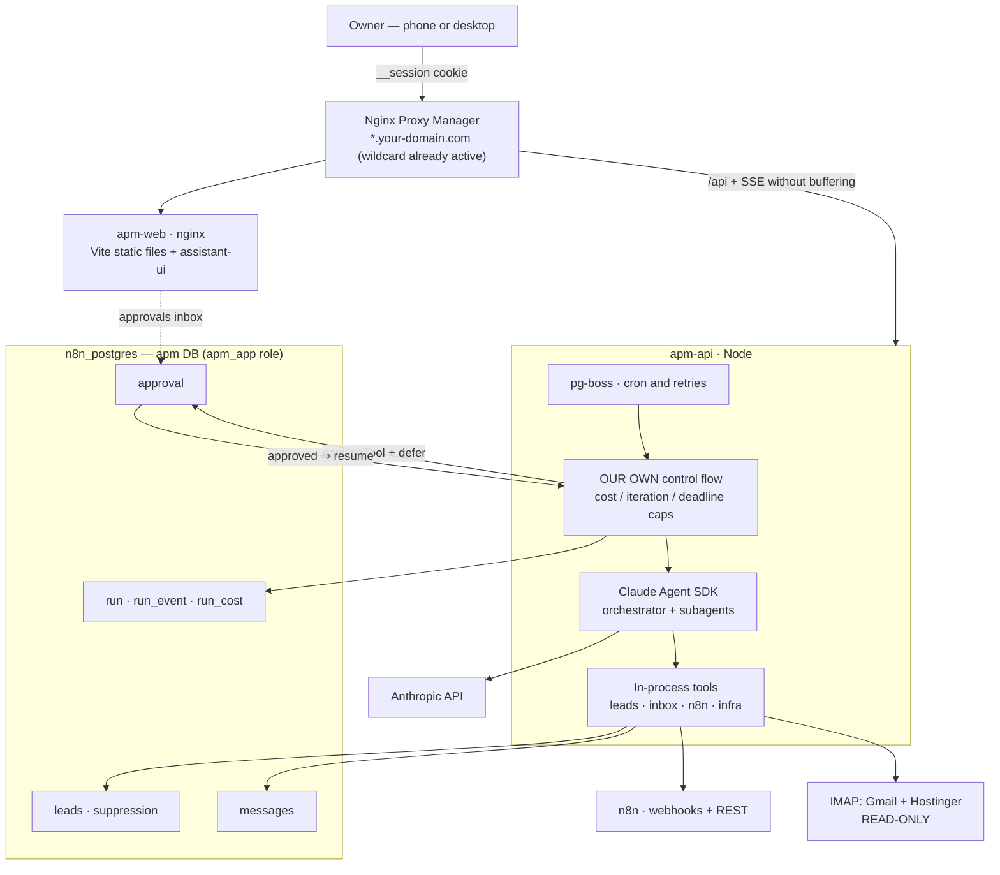

# RESEARCH — APM stack decision

**Date:** August 2, 2026
**Status:** end of Phase 0. This document does **not** repeat the reports: it resolves them.
**For the detail on each topic:** `docs/research/A..H`.

> This document and `ARCHITECTURE.md` are what goes through **GATE 0**.
> Everything marked ✅ is verified against a primary source; ⚠️ is an estimate or unverified.

---

## 1. What APM is, in one sentence

> The company's personal command center at `apm.your-domain.com`: a chat box with
> agents that **do** things (find leads, triage email, trigger automations, watch
> the products), with **human approval** for anything that goes outside and
> **measured cost** for every run.

**And what it is NOT**, so nobody gets confused halfway:

- It's not a customer product. It's internal. One user: the owner. (Multi-tenant
  is out of scope for Phases 1-6; if it's ever sold, it gets rethought.)
- It's not an agent framework. The Claude Agent SDK provides that.
- It's not a replacement for n8n. n8n keeps running what it runs; APM triggers it
  and reads it.
- It's not an observability platform. Two tables and a panel, not ClickHouse.

---

## 2. The four open decisions — resolved

### Decision 1 — React or not?

**Recommendation: YES, but React + Vite (SPA), NOT Next.js.**

| | Option A — **Vite + React** ✅ recommended | Option B — Vanilla, like the main website |
|---|---|---|
| Chat UI | `assistant-ui` solves it (report C) | Hand-write streaming + tool UI + approvals |
| Server RAM cost | **Zero.** The build happens when the image is built; nginx serves static files | Zero |
| Cache busting | Automatic (build hash) | `node tools/cachebust.js` by hand |
| New stack on the VPS | Yes: build-time Node + bundler | No |
| Time to the first useful chat | Days | ⚠️ Weeks |

The decisive argument **isn't fashion, it's scope**: Phase 2 calls for *streaming chat +
per-tool generative UI + human approval*. That's exactly what `assistant-ui` gives
for free and what vanilla would have to write from scratch, badly, and maintain.

**And the counter-argument falls apart on inspection:** the reasonable fear of React is
"one more Node service eating RAM". With **Vite (SPA, no SSR) that doesn't happen**:
`npm run build` produces static HTML/JS/CSS inside the `Dockerfile`, and in production only
**nginx** runs, same as the main website. Next.js would bring a Node process into
production → **ruled out**.

Conditions inherited from H (non-negotiable): identical Spectra tokens, **light theme by
default** via `body[data-theme="light"]`, self-hosted fonts (no Google Fonts), no CDN,
and usable at **390 px**.

### Decision 2 — RAM budget

**Recommendation: an explicit ceiling in the code, not a good intention.**

Starting point (G.1 ✅): 7.7 GB total, **4.6 GB free**, 2 cores, **1 GB of swap already in use**.

| Component | Estimate | Note |
|---|---|---|
| `apm-api` (Node + Express + pg) at rest | ⚠️ 150-250 MB | To be measured |
| **Each active SDK agent** | **~1 GiB** | *Official* floor, "a floor, not the ceiling" ✅ (report A) |
| Playwright scraping worker (throwaway) | ⚠️ 300-500 MB, only while running | Concurrency 1 |
| `apm-web` (nginx static) | ~10 MB | |
| pg-boss, `apm` DB | Negligible | Reuse the existing Postgres |

→ **`MAX_CONCURRENT_RUNS=2`** as a config constant from the first commit, and the
scraping worker **never runs at the same time** as 2 agents. With 3 simultaneous agents
we hit swap, and the VPS already touches swap without APM.

**What this budget rules out** (§6): Firecrawl, Langfuse+ClickHouse, Temporal/Restate/
Inngest, a new Postgres, any additional always-on headless browser.

### Decision 3 — Scheduler

**Recommendation: `pg-boss` inside APM.** ✅ Already settled in report F and there's no
reason to reopen it: v12.26.4, MIT, **3 dependencies**, published 1-Aug-2026 ✅.

The argument that wins is **atomicity**: `INSERT` of the data **and** enqueueing of the job in
the same Postgres transaction. With BullMQ+Redis that's impossible (two systems) and the
"the job exists but the data doesn't" bug appears. Also, the existing Redis belongs to n8n:
someone else's `FLUSHALL` would take APM's jobs with it. Postgres is already backed up and
encrypted to R2.

**Expansion path noted, not adopted:** DBOS Transact (`@dbos-inc/dbos-sdk` 4.25.14, MIT,
6 deps ✅) gives in-process execution durability on **the same Postgres**, with no new
infrastructure. ⚠️ Its coexistence with pg-boss is unverified. Future spike.

### Decision 4 — n8n: MCP vs REST

**Recommendation: webhooks to trigger + REST API to monitor.** ✅ Settled in F, with a
finding that closes it: **the n8n REST API has no endpoint to run workflows** ✅. The MCP
Server Trigger adds SSE, buffering behind NPM and long sessions in exchange for nothing
webhook+API don't give → **optional, Phase 2**.

Agreed split rule: *whoever needs to know whether it worked is the one who schedules it.*

---

## 3. The chosen stack

| Layer | Choice | Report |
|---|---|---|
| Agent runtime | **Claude Agent SDK** `@anthropic-ai/claude-agent-sdk` 0.3.220 ✅ | A |
| Orchestration | **Our own** (our control flow), orchestrator-worker pattern only where it parallelizes | B |
| Frontend | **Vite + React + assistant-ui**, served as static files by nginx | C, H |
| Backend | Node ≥18 + Express + `pg` (same pattern as the main website) | G |
| Database | New **`apm`** DB, **`apm_app`** role, in the existing `n8n_postgres` ✅ | G |
| Queue / cron | **pg-boss** 12.26.4 ✅ | F |
| Auth | **`__session` SSO cookie** from the parent domain + mandatory `restoreSession` ✅ | G |
| TLS / domain | Wildcard `*.your-domain.com` already active in NPM → just create the Proxy Host ✅ | G |
| Email | **Our own read-only IMAP** connector (`imapflow`) via `createSdkMcpServer` | E |
| Automations | **n8n webhook** (trigger) + **REST API** (monitoring) ✅ | F |
| Leads | **FMCSA census** (free, public domain) + throwaway-Playwright enrichment | D |
| Observability | **Our own tables** with OTel GenAI semconv names | B |
| Design | Real **Spectra** tokens, light theme by default, self-hosted fonts | H |

---

## 4. Models and cost

IDs and prices **verified** in this session — this **resolves risk 2 in report A**
("I don't cite any specific ID so as not to invent it"):

| Model | Exact ID | Context | Input $/MTok | Output $/MTok |
|---|---|---|---|---|
| Claude Opus 5 | `claude-opus-5` | 1M | **$5** | **$25** |
| Claude Sonnet 5 | `claude-sonnet-5` | 1M | $3 (**$2 promo until 31-Aug-2026**) | $15 (**$10 promo**) |
| Claude Haiku 4.5 | `claude-haiku-4-5` | 200K | $1 | $5 |

**Prompt caching** (the biggest cost lever, and the most ignored):

- Cache read ≈ **0.1×** the input price.
- Cache write **1.25×** (5-min TTL) or **2×** (1-h TTL).
- Break-even: with a 5-min TTL, **it already pays off on the second request**.
- Minimum cacheable: **512 tokens on Opus 5**, 1024 on Sonnet 5. Below that it **doesn't
  cache and doesn't warn you** (`cache_creation_input_tokens: 0`).

**Proposed model split for APM:**

| Work | Model | Why |
|---|---|---|
| Orchestrator / main chat | `claude-opus-5` | It's the one deciding; mistakes here cost more than tokens |
| Sweep subagents (leads, summaries) | `claude-sonnet-5` | Volume; and with the August promo it's half price |
| Email classification and triage | `claude-haiku-4-5` | "is this urgent yes/no?" doesn't need Opus |

(In production the default ended up being Haiku for everything, with the option to move up
from the chat: see `api/agent.js`.)

⚠️ **Prices are NOT hard-coded.** They go in a config table (`model_pricing`), because they
change — the Sonnet promo ends on **31-Aug-2026**, and if it's in the code the cost panel
starts lying that day, silently.

**Cost rules that go into the code, not a document:**

1. The system prompt **is frozen**. No `new Date()` inside: any byte that changes at the
   start invalidates the whole cache behind it.
2. Account with **`total_cost_usd` and `modelUsage`**, never with plain `usage`: `usage`
   **excludes subagent tokens** ✅ (correction to report A). Billing by `usage` would
   underestimate the real spend exactly on the most expensive runs.
3. A **daily** budget cap in dollars. When reached, the orchestrator refuses to launch
   subagents. With the multi-agent **15×** multiplier ✅ (report B), this isn't a pretty
   metric: it's the handbrake.

---

## 5. How the pieces relate

---

## 6. What was ruled out, and why

A rejection without a reason reopens itself three months later. These won't:

| Ruled out | Reason |
|---|---|
| **Next.js** | Would bring a Node process into production. Vite gives the same with nginx. |
| **Firecrawl** (self-host) | ⚠️ Its own compose recommends 4 vCPU / 8 GB just for `api`. **More RAM than the whole VPS.** |
| **Langfuse** | Requires Postgres + **ClickHouse** + Redis + S3 ✅. It would spend the free RAM on looking at charts. |
| **Helicone** | ⚠️ Acquired by Mintlify (Mar-2026), no roadmap. |
| **Temporal / Restate / Inngest** | Excellent, but each is **one more server**. For a single user, Postgres + pg-boss cover the real requirement. |
| **BullMQ** | The existing Redis belongs to n8n. No atomicity with our data. |
| **n8n MCP Server Trigger (Phase 1)** | SSE + buffering behind NPM in exchange for nothing webhook+API don't give. |
| **`builderz-labs/mission-control`** | It's a control plane *over* runtimes; APM needs the agent **inside**. Alpha, incomplete access control ✅. |
| **Google Maps scraping** | Worse data than the (free) FMCSA census, more fragile, more legal risk, and paid proxies. |
| **Places API as the CRM's origin** | Its policy forbids storing the content; only the `place_id` is indefinite ✅. |
| **`yt-dlp` and YouTube comments** | The ToS literally forbid "collecting information that could identify a person" ✅. |
| **Third-party email MCP** | A process with our mailbox credentials and network egress. Our own connector is read-only **by construction**. |
| **A new Postgres** | Using the existing one saves ~150-250 MB, and it already has verified encrypted backups. |

(Note: Phase 3 later did add a gentle, internal-only Google Maps scraper next to NYC Open
Data — see `api/sources/google-maps.js` for the limits that came with that decision.)

---

## 7. Risks, by severity

| # | Risk | Impact | Mitigation |
|---|---|---|---|
| 1 | ⚠️ **`SessionStore` + `defer` untested.** It's not confirmed that a deferred approval survives a container restart | **The whole approval architecture** | **Spike #1 of Phase 2, before writing anything else.** If it fails, plan B: approval doesn't pause the agent, it kills it and relaunches with the saved context. (Resolved: SPIKE-01 and SPIKE-02 — it survives.) |
| 2 | ⚠️ **~1 GiB per agent is an official floor, not a measurement** | The ceiling of 2 concurrent may be 1 | Measure in the spike before promising anything |
| 3 | ⚠️ **The Agent SDK commercial license** unread (risk 1 in report A) | Blocks reselling APM someday | Read the *Commercial ToS* before thinking about selling. **For internal use it doesn't block Phase 1** |
| 4 | ⚠️ **CAN-SPAM: $53,088 per email** and a mandatory postal address | Existential if sending goes wrong | A business decision before Phase 3 (§8). Sending = the last thing built |
| 5 | ⚠️ **Real DSP coverage in the FMCSA census** unverified | The lead source might not cover the niche | Download, filter by NJ/NY and **count**. Cheap, first step of Phase 3. (Resolved: it doesn't — see `FASE3-fuente-leads.md`.) |
| 6 | **Prompt injection via email** | An email with instructions inside steering the agent | Read-only connector + sanitizing + untrusted-content envelope + human approval to send (report E §5) |
| 7 | ⚠️ **Unrotated keys** on the same server | Unrelated to APM but it shares the VPS and Postgres | **Rotate before adding one more credential** to that machine |
| 8 | The VPS already touches swap | Everything degrades, not just APM | `MAX_CONCURRENT_RUNS=2` + watch it; if that's not enough, the answer is more RAM, not more cleverness |

---

## 8. Changes proposed to the PLAN

1. **Phase 3** — replace *"Company scraper (Google Maps) end-to-end"* with
   **"FMCSA census importer + web enrichment"**. Cheaper, more complete, no legal risk
   (report D §8).
2. **Phase 3** — add a **suppression table (unsubscribes and bounces)** as an explicit task,
   not something that "will come up". It goes before the first send.
3. **Phase 2** — the first task stops being "Claude Agent SDK in the backend" and becomes the
   **`SessionStore` + `defer` spike**. Everything else depends on it.
4. **Phase 1** — add `MAX_CONCURRENT_RUNS` and the `model_pricing` table to migration 001.

---

## 9. What's needed from the owner to pass GATE 0

Four answers. The first three don't block Phase 1 if they take time; the fourth does.

1. **React (Vite) or vanilla?** — Vite recommended. (Blocks Phase 1.)
2. **Postal address for commercial email?** — a business mailbox/PO Box, **not the home
   address**. (Blocks Phase 3, not 1.)
3. **Contact the US only?** — yes recommended, with a country filter in the code.
   (Blocks Phase 3.)
4. **Daily token budget in dollars?** — a number is needed for the handbrake. Suggested
   start: **$5/day**, adjustable from the dashboard.

---

## Appendix — Report index

| Report | Topic | Status |
|---|---|---|
| `research/A-agent-sdk.md` | Claude Agent SDK: types, sessions, `canUseTool`, hooks, cost | ✅ |
| `research/B-arquitecturas.md` | Orchestrator-worker, durability, HITL, observability | ✅ |
| `research/C-ui-chat.md` | Chat UI and generative UI → assistant-ui | ✅ |
| `research/D-scrapers-leads.md` | Company and video leads + legal/ToS | ✅ |
| `research/E-email.md` | Gmail + Hostinger IMAP, our own read-only connector | ✅ |
| `research/F-n8n-automatizaciones.md` | n8n bridge, scheduler, NPM SSE config | ✅ |
| `research/G-infra-real.md` | The real VPS: RAM, networks, Postgres, SSO, TLS (kept private) | ✅ |
| `research/H-spectra-tokens.md` | The main website's real design tokens | ✅ |
