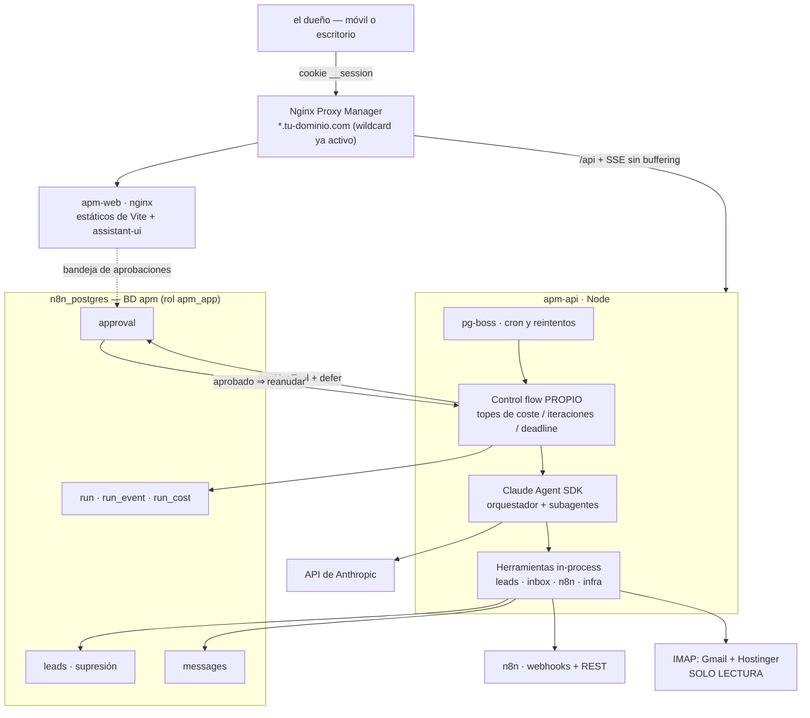

# RESEARCH — Decisión de stack de APM

**Fecha:** 2 de agosto de 2026
**Estado:** cierre de la Fase 0. Este documento **no** repite los informes: los resuelve.
**Para leer el detalle de cada tema:** `docs/research/A..H`.

> Este documento y `ARCHITECTURE.md` son lo que se somete al **GATE 0**.
> Todo lo marcado ✅ está verificado contra fuente primaria; ⚠️ es estimación o sin verificar.

---

## 1. Qué es APM, en una frase

> El centro de mando personal de tu empresa en `apm.tu-dominio.com`: una caja de chat con
> agentes que **hacen** cosas (buscar leads, triar el correo, disparar automatizaciones,
> vigilar los productos), con **aprobación humana** para todo lo que salga al exterior y
> **coste medido** en cada ejecución.

**Y lo que NO es**, para que nadie lo confunda a mitad de camino:

- No es un producto para clientes. Es interno. Un usuario: el dueño. (Multi-tenant queda fuera
  de la Fase 1-6; si algún día se vende, se replantea.)
- No es un framework de agentes. Eso lo pone el Claude Agent SDK.
- No es un reemplazo de n8n. n8n sigue ejecutando lo que ya ejecuta; APM lo dispara y lee.
- No es una plataforma de observabilidad. Dos tablas y un panel, no ClickHouse.

---

## 2. Las cuatro decisiones abiertas — resueltas

### Decisión 1 — ¿React sí o no?

**Recomendación: SÍ, pero React + Vite (SPA), NO Next.js.**

| | Opción A — **Vite + React** ✅ recomendada | Opción B — Vanilla, como `tu web principal` |
|---|---|---|
| UI de chat | `assistant-ui` resuelto (informe C) | Reescribir a mano streaming + tool UI + aprobaciones |
| Coste de RAM en el servidor | **Cero.** El build ocurre al construir la imagen; nginx sirve estáticos | Cero |
| Cache busting | Automático (hash de build) | `node tools/cachebust.js` a mano |
| Stack nuevo en la VPS | Sí: Node de build + bundler | No |
| Tiempo hasta el primer chat útil | Días | ⚠️ Semanas |

El argumento decisivo **no es la moda, es el alcance**: la Fase 2 pide *chat con streaming +
generative UI por herramienta + aprobación humana*. Eso es exactamente lo que `assistant-ui`
regala y lo que en vanilla habría que escribir desde cero, mal, y mantener.

**Y el argumento en contra se cae al mirarlo:** el miedo razonable a React es "un servicio
Node más comiendo RAM". Con **Vite (SPA, sin SSR) eso no pasa**: `npm run build` genera
HTML/JS/CSS estáticos dentro del `Dockerfile`, y en producción solo corre **nginx**, igual
que en `tu web principal`. Next.js sí traería un proceso Node en producción → **descartado**.

Condiciones que hereda de H (no negociables): tokens Spectra idénticos, tema **claro por
defecto** vía `body[data-theme="light"]`, fuentes self-hosted (nada de Google Fonts), sin
CDN, y usable a **390 px**.

### Decisión 2 — Presupuesto de RAM

**Recomendación: un techo explícito en el código, no una buena intención.**

Punto de partida (G.1 ✅): 7,7 GB totales, **4,6 GB libres**, 2 núcleos, **1 GB de swap ya en uso**.

| Componente | Estimación | Nota |
|---|---|---|
| `apm-api` (Node + Express + pg) en reposo | ⚠️ 150-250 MB | A medir |
| **Cada agente activo del SDK** | **~1 GiB** | Suelo *oficial*, "a floor, not the ceiling" ✅ (informe A) |
| Worker Playwright de scraping (efímero) | ⚠️ 300-500 MB, solo mientras corre | Concurrencia 1 |
| `apm-web` (nginx estáticos) | ~10 MB | |
| pg-boss, BD `apm` | Despreciable | Reusan Postgres existente |

→ **`MAX_CONCURRENT_RUNS=2`** como constante de configuración desde el primer commit, y el
worker de scraping **no corre a la vez** que 2 agentes. Con 3 agentes simultáneos entramos en
swap, y la VPS ya está tocando swap sin APM.

**Lo que este presupuesto descarta** (§6): Firecrawl, Langfuse+ClickHouse, Temporal/Restate/
Inngest, un Postgres nuevo, cualquier navegador headless permanente adicional.

### Decisión 3 — Scheduler

**Recomendación: `pg-boss` dentro de APM.** ✅ Ya resuelto en el informe F y no hay motivo
para reabrirlo: v12.26.4, MIT, **3 dependencias**, publicado el 1-ago-2026 ✅.

El argumento que manda es la **atomicidad**: `INSERT` del dato **y** encolado del job en la
misma transacción de Postgres. Con BullMQ+Redis eso es imposible (dos sistemas) y aparece el
bug de "el job existe pero el dato no". Además el Redis existente es de n8n: un `FLUSHALL`
ajeno se llevaría los jobs de APM. Postgres ya está respaldado y cifrado a R2.

**Camino de ampliación anotado, no adoptado:** DBOS Transact (`@dbos-inc/dbos-sdk` 4.25.14,
MIT, 6 deps ✅) da durabilidad de ejecución in-process sobre **el mismo Postgres**, sin
infraestructura nueva. ⚠️ Sin verificar su convivencia con pg-boss. Spike futuro.

### Decisión 4 — n8n: MCP vs REST

**Recomendación: webhooks para disparar + REST API para monitorear.** ✅ Resuelto en F, con
un hallazgo que lo cierra: **la REST API de n8n no tiene endpoint para ejecutar workflows** ✅.
El MCP Server Trigger añade SSE, buffering tras NPM y sesiones largas a cambio de nada que
webhook+API no den → **opcional, Fase 2**.

Regla de reparto ya acordada: *el que necesita saber si funcionó, es el que programa.*

---

## 3. El stack elegido

| Capa | Elección | Informe |
|---|---|---|
| Runtime de agentes | **Claude Agent SDK** `@anthropic-ai/claude-agent-sdk` 0.3.220 ✅ | A |
| Orquestación | **Propia** (control flow nuestro), patrón orquestador-worker solo si paraleliza | B |
| Frontend | **Vite + React + assistant-ui**, servido como estáticos por nginx | C, H |
| Backend | Node ≥18 + Express + `pg` (mismo patrón que `tu web principal`) | G |
| Base de datos | BD **`apm`** nueva, rol **`apm_app`**, en el `n8n_postgres` existente ✅ | G |
| Cola / cron | **pg-boss** 12.26.4 ✅ | F |
| Auth | **Cookie SSO `__session`** de `.tu-dominio.com` + `restoreSession` obligatorio ✅ | G |
| TLS / dominio | Wildcard `*.tu-dominio.com` ya activo en NPM → solo crear el Proxy Host ✅ | G |
| Correo | Conector **IMAP propio de solo lectura** (`imapflow`) vía `createSdkMcpServer` | E |
| Automatizaciones | **Webhook n8n** (disparo) + **REST API** (monitoreo) ✅ | F |
| Leads | **Censo FMCSA** (gratis, dominio público) + enriquecimiento con Playwright efímero | D |
| Observabilidad | **Tablas propias** con nombres de la semconv GenAI de OTel | B |
| Diseño | Tokens **Spectra** reales, tema claro por defecto, fuentes self-hosted | H |

---

## 4. Modelos y coste

IDs y precios **verificados** en esta sesión — esto **resuelve el riesgo 2 del informe A**
("no cito ningún ID concreto para no inventarlo"):

| Modelo | ID exacto | Contexto | Entrada $/MTok | Salida $/MTok |
|---|---|---|---|---|
| Claude Opus 5 | `claude-opus-5` | 1M | **$5** | **$25** |
| Claude Sonnet 5 | `claude-sonnet-5` | 1M | $3 (**$2 promo hasta 31-ago-2026**) | $15 (**$10 promo**) |
| Claude Haiku 4.5 | `claude-haiku-4-5` | 200K | $1 | $5 |

**Caché de prompt** (la palanca de coste más grande y la más ignorada):

- Lectura de caché ≈ **0,1×** el precio de entrada.
- Escritura de caché **1,25×** (TTL 5 min) o **2×** (TTL 1 h).
- Punto de equilibrio: con TTL de 5 min, **a la segunda petición ya sale a cuenta**.
- Mínimo cacheable: **512 tokens en Opus 5**, 1024 en Sonnet 5. Por debajo **no cachea y no
  avisa** (`cache_creation_input_tokens: 0`).

**Reparto de modelos propuesto para APM:**

| Trabajo | Modelo | Por qué |
|---|---|---|
| Orquestador / chat principal | `claude-opus-5` | Es quien decide; equivocarse aquí cuesta más que el token |
| Subagentes de barrido (leads, resúmenes) | `claude-sonnet-5` | Volumen; y con la promo de agosto sale a mitad |
| Clasificación y triaje de correo | `claude-haiku-4-5` | "¿esto es urgente sí/no?" no necesita Opus |

⚠️ **Los precios NO se hardcodean.** Van en una tabla de configuración (`model_pricing`),
porque cambian — la promo de Sonnet vence el **31-ago-2026** y si está en el código, el
panel de costes empieza a mentir ese día en silencio.

**Reglas de coste que van al código, no a un documento:**

1. El prompt del sistema **se congela**. Nada de `new Date()` dentro: cualquier byte que
   cambie al principio invalida toda la caché por detrás.
2. Contabilizar con **`total_cost_usd` y `modelUsage`**, nunca con `usage` a secas: `usage`
   **excluye los tokens de los subagentes** ✅ (corrección del informe A). Facturar por
   `usage` sería subestimar el gasto real justo en las ejecuciones más caras.
3. Tope de presupuesto **diario** en dólares. Al alcanzarlo, el orquestador se niega a
   lanzar subagentes. Con el multiplicador **15×** del multi-agente ✅ (informe B), esto no
   es una métrica bonita: es el freno de mano.

---

## 5. Cómo se relacionan las piezas

---

## 6. Descartes, con el motivo

Un descarte sin motivo se reabre solo dentro de tres meses. Estos no:

| Descartado | Motivo |
|---|---|
| **Next.js** | Traería un proceso Node a producción. Vite da lo mismo con nginx. |
| **Firecrawl** (self-host) | ⚠️ Su propio compose recomienda 4 vCPU / 8 GB solo para `api`. **Más RAM que la VPS entera.** |
| **Langfuse** | Exige Postgres + **ClickHouse** + Redis + S3 ✅. Gastaría la RAM libre en mirar gráficos. |
| **Helicone** | ⚠️ Adquirido por Mintlify (mar-2026), sin roadmap. |
| **Temporal / Restate / Inngest** | Excelentes, pero son **un servidor más**. Para un solo usuario, Postgres + pg-boss cubren el requisito real. |
| **BullMQ** | El Redis existente es de n8n. Sin atomicidad con nuestros datos. |
| **MCP Server Trigger de n8n (Fase 1)** | SSE + buffering tras NPM a cambio de nada que webhook+API no den. |
| **`builderz-labs/mission-control`** | Es un control plane *sobre* runtimes; APM necesita el agente **dentro**. Alpha, control de acceso incompleto ✅. |
| **Scraping de Google Maps** | Peores datos que el censo FMCSA (gratis), más frágil, más riesgo legal, y proxies de pago. |
| **Places API como origen del CRM** | Su política prohíbe almacenar el contenido; solo el `place_id` es indefinido ✅. |
| **`yt-dlp` y comentarios de YouTube** | Los ToS prohíben literalmente "recolectar información que pueda identificar a una persona" ✅. |
| **MCP de correo de terceros** | Un proceso con nuestras credenciales de buzón y salida a red. El conector propio es solo-lectura **por construcción**. |
| **Un Postgres nuevo** | Ahorramos ~150-250 MB usando el existente, que además ya tiene backups cifrados verificados. |

---

## 7. Riesgos, por gravedad

| # | Riesgo | Impacto | Mitigación |
|---|---|---|---|
| 1 | ⚠️ **`SessionStore` + `defer` sin probar.** No está confirmado que una aprobación diferida sobreviva al reinicio del contenedor | **Toda la arquitectura de aprobaciones** | **Spike nº1 de la Fase 2, antes de escribir nada más.** Si falla, plan B: la aprobación no pausa al agente, lo mata y se re-lanza con el contexto guardado |
| 2 | ⚠️ **~1 GiB por agente es un suelo oficial, no una medición** | El techo de 2 concurrentes puede ser 1 | Medir en el spike antes de prometer nada |
| 3 | ⚠️ **Licencia comercial del Agent SDK** sin leer (riesgo 1 del informe A) | Bloquea revender APM algún día | Leer los *Commercial ToS* antes de pensar en vender. **Para uso interno no bloquea la Fase 1** |
| 4 | ⚠️ **CAN-SPAM: $53.088 por correo** y dirección postal obligatoria | Existencial si se envía mal | Decisión de negocio antes de la Fase 3 (§8). Envío = lo último que se construye |
| 5 | ⚠️ **Cobertura real de DSP en el censo FMCSA** sin comprobar | La fuente de leads podría no cubrir el nicho | Descargar, filtrar por NJ/NY y **contar**. Barato, primer paso de la Fase 3 |
| 6 | **Prompt injection por correo** | Un correo con instrucciones dentro moviendo al agente | Conector solo-lectura + saneado + envelope de contenido no confiable + aprobación humana para enviar (informe E §5) |
| 7 | ⚠️ **Claves sin rotar** (memoria `secreto-en-git`: Stripe, Firebase, FLEET_CRED_KEY) | Ajeno a APM pero comparte VPS y Postgres | **Rotar antes de meter una credencial más** en esa máquina |
| 8 | La VPS ya toca swap | Degradación de todo, no solo de APM | `MAX_CONCURRENT_RUNS=2` + vigilar; si no basta, la respuesta es más RAM, no más ingenio |

---

## 8. Cambios que propongo al PLAN

1. **Fase 3** — cambiar *"Scraper de empresas (Google Maps) end-to-end"* por
   **"Importador del censo FMCSA + enriquecimiento web"**. Más barato, más completo,
   sin riesgo legal (informe D §8).
2. **Fase 3** — añadir **tabla de supresión (bajas y rebotes)** como tarea explícita, no
   como algo "que ya saldrá". Va antes del primer envío.
3. **Fase 2** — la primera tarea deja de ser "Claude Agent SDK en el backend" y pasa a ser
   el **spike de `SessionStore` + `defer`**. Todo lo demás depende de él.
4. **Fase 1** — añadir `MAX_CONCURRENT_RUNS` y la tabla `model_pricing` a la migración 001.

---

## 9. Lo que necesito de el dueño para pasar el GATE 0

Cuatro respuestas. Las tres primeras no bloquean la Fase 1 si tardan; la cuarta sí.

1. **¿React (Vite) o vanilla?** — recomiendo Vite. (Bloquea la Fase 1.)
2. **¿Dirección postal para el correo comercial?** — buzón comercial/PO Box, **no la casa**.
   (Bloquea la Fase 3, no la 1.)
3. **¿Se contacta solo a EE. UU.?** — recomiendo sí, con filtro de país en el código.
   (Bloquea la Fase 3.)
4. **¿Presupuesto diario de tokens en dólares?** — necesito un número para poner el freno de
   mano. Sugerencia de arranque: **$5/día**, ajustable desde el panel.

---

## Anexo — Índice de informes

| Informe | Tema | Estado |
|---|---|---|
| `research/A-agent-sdk.md` | Claude Agent SDK: tipos, sesiones, `canUseTool`, hooks, coste | ✅ |
| `research/B-arquitecturas.md` | Orquestador-worker, durabilidad, HITL, observabilidad | ✅ |
| `research/C-ui-chat.md` | UI de chat y generative UI → assistant-ui | ✅ |
| `research/D-scrapers-leads.md` | Leads de empresas y video + legal/ToS | ✅ |
| `research/E-email.md` | Gmail + IMAP Hostinger, conector propio de solo lectura | ✅ |
| `research/F-n8n-automatizaciones.md` | Puente n8n, scheduler, config SSE de NPM | ✅ |
| `research/G-infra-real.md` | La VPS real: RAM, redes, Postgres, SSO, TLS | ✅ |
| `research/H-spectra-tokens.md` | Tokens de diseño reales de `tu web principal` | ✅ |
