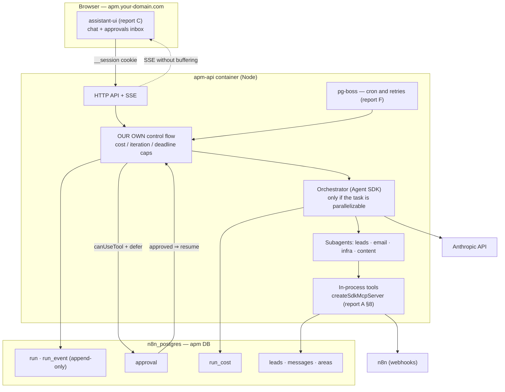

# Category B — Reference architectures (mission control / orchestrators)

**Research date:** August 2, 2026
**Question it answers:** how is an agent "command center" structured inside? Which
orchestration pattern do we copy, how are runs persisted, how are sensitive actions
approved and how is cost measured — all within 2 cores and 4.6 GB free?

**Everything marked ✅ is verified against the GitHub API, the npm registry or the official
documentation on this date.** Anything ⚠️ NOT VERIFIED is flagged explicitly.

Depends on: `G-infra-real.md` (host constraints), `A-agent-sdk.md` (agent runtime),
`F-n8n-automatizaciones.md` (scheduler and SSE).

---

## 0. One-line recommendation

> **APM builds its own control plane** (Node + Postgres + pg-boss, already decided in F),
> applies Anthropic's **orchestrator-worker** pattern *only* when the task can be
> parallelized, stores each run as an **append-only event log in Postgres** (factor 12), and
> **rules out the whole canned observability layer** (Langfuse, Helicone, Phoenix) for RAM
> cost: cost logging lives in two of our own tables using the **OpenTelemetry GenAI semconv**
> attribute names, so it can be exported to a collector the day it's needed.

What NOT to build: an agent framework (the Agent SDK provides it), a durability engine
(Postgres + pg-boss are more than enough at this scale) and a chat UI (assistant-ui, report C).

---

## 1. Verified sources

| Repo / source | ★ | License | Last push | What it brings |
|---|---|---|---|---|
| `anthropic.com/engineering/multi-agent-research-system` | — | official article | — | The orchestrator-worker pattern with real numbers ✅ |
| `humanlayer/12-factor-agents` | **25,036** ✅ | NOASSERTION ⚠️ | **2025-09-21** (stalled) ✅ | The own-your-control-flow principles |
| `builderz-labs/mission-control` | **5,902** ✅ | MIT ✅ | 2026-07-27 ✅ | A ready-made self-hosted control plane (alpha) |
| `dbos-inc/dbos-transact-ts` | 1,303 ✅ | MIT ✅ | 2026-07-30 ✅ | In-process durability on Postgres |
| `langchain-ai/agent-inbox` | 1,041 ✅ | MIT ✅ | 2026-07-27 ✅ | Inbox UX for approvals |
| `inngest/inngest` | 5,679 ✅ | NOASSERTION ⚠️ | 2026-08-02 ✅ | Durable execution as a service |
| `restatedev/restate` | 4,240 ✅ | NOASSERTION ⚠️ | 2026-08-02 ✅ | Lightweight durable execution (Rust) |
| `temporalio/sdk-typescript` | 890 ✅ | MIT ✅ | 2026-08-01 ✅ | The reference for durability at scale |
| `langfuse/langfuse` | **32,349** ✅ | NOASSERTION ⚠️ | 2026-08-01 ✅ | LLM observability (heavy) |
| `Arize-ai/phoenix` | 10,861 ✅ | NOASSERTION ⚠️ | 2026-08-02 ✅ | Observability + evals |
| `Helicone/helicone` | 6,028 ✅ | Apache-2.0 ✅ | 2026-07-25 ✅ | Cost gateway — **see §7, it's dead** |
| `openlit/openlit` | 2,666 ✅ | Apache-2.0 ✅ | 2026-08-01 ✅ | OTel-native observability |

npm versions checked on 2-Aug-2026 against `registry.npmjs.org` ✅:

| Package | Version | Published | License | Direct deps |
|---|---|---|---|---|
| `@anthropic-ai/claude-agent-sdk` | 0.3.220 | 2026-07-24 | SEE LICENSE IN README ⚠️ | **0** |
| `pg-boss` | 12.26.4 | 2026-08-01 | MIT | **3** |
| `@dbos-inc/dbos-sdk` | 4.25.14 | 2026-07-30 | MIT | **6** |

---

## 2. The reference pattern: orchestrator-worker (Anthropic)

It's the architecture of Anthropic's Research system, and the only one published with
production numbers. Verified summary of the official article ✅:

- A **lead agent** (Opus) analyzes the request, decides the strategy and **launches
  subagents** (Sonnet) that work **in parallel**.
- Each subagent gets four mandatory things: **objective, output format, tool/source guidance
  and explicit task boundaries**. Short instructions like "research the shortage" produce
  duplicated work across subagents.
- **A scaling rule embedded in the lead's prompt**: simple query → 1 agent and 3-10 calls;
  comparison → 2-4 agents with 10-15 calls each; complex research → 10+ agents with split
  responsibilities.
- The lead spins up **3-5 subagents in parallel**, and each subagent uses **3+ tools in
  parallel**. This cut **up to 90% of the time** on complex queries.
- **External memory**: before filling the window (200,000 tokens) the lead saves the plan
  outside the context; large subagent outputs go to an external store and only a
  **lightweight reference** returns to the coordinator, not the content.
- A dedicated **citations agent**: a later step that walks the report and ties each claim to
  its source. (For APM this translates into a verification subagent that ties each lead to
  the URL it came from.)

### 2.1 The number that drives the design: **15×**

| Mode | Token usage |
|---|---|
| Normal chat | 1× |
| Agent with tools | **~4×** |
| Multi-agent system | **~15×** |

Measured improvement: **+90.2%** over a single agent in their internal research eval. ✅

**Reading for APM (my opinion, not the article's):** the 15× multiplier is acceptable when
the result is sold (a batch of qualified leads) and unacceptable as the chat box's default
mode. The article says explicitly that multi-agent **doesn't pay off** when every agent needs
the same context, when there are many interdependencies, or when the value doesn't justify
the cost.

→ **Design decision:** APM starts **single-agent with tools** for everything, and orchestrator
mode is enabled **only** for explicitly parallelizable tasks (lead sweep across N areas,
teardown of N competitors). The orchestrator itself must carry a cap on subagents and on
cost per run (§5.3).

### 2.2 What the article warns about production

- Agents are **stateful**: a small failure doesn't stay small, it mutates the behavior.
- You must be able to **resume from the point of failure**, not restart (expensive and
  frustrating).
- They're **non-deterministic** with the same prompt → without full traces, debugging is
  impossible.
- **Rainbow deployments**: when deploying, old and new versions coexist so half-finished runs
  aren't cut off. ⚠️ For APM this is overkill today, but it implies a cheap rule: **before
  `docker compose up --build`, there must be no live runs** (or they're marked interrupted
  and resumed). This goes into the deployment runbook.

---

## 3. The 12 factors, filtered to what applies to us

`humanlayer/12-factor-agents` (25,036 ★) is the industry's most cited reference, but
⚠️ **its last push was in September 2025**: it's a principles document, not a dependency.
The three that change APM's design:

1. **Factor 8 — own your control flow.** The `while` loop is ours: we decide when it retries,
   when it pauses, when it stops. The model picks the *next action*, not the lifecycle. In
   practice: iteration, cost and time caps **in our code**, never "trusting" the prompt to
   respect them.
2. **Factor 12 — the agent as a stateless reducer**: `f(events) -> next action`. The source
   of truth is the **event log**, not process memory. That's what lets us restart the
   container without losing anything.
3. **Contacting humans is just another tool**, not a special case of the framework. It fits
   exactly with the Agent SDK's `canUseTool` + `defer` (report A §6).

It's consistent with what we already chose in A and C. It brings no code; it brings the
discipline of **not delegating to a framework what is our own business**.

---

## 4. What if we adopt a ready-made control plane? (honest build vs adopt)

`builderz-labs/mission-control` — 5,902 ★, MIT, push 2026-07-27 ✅ — is literally a
"self-hosted control plane for agents: dispatch tasks, review runs, control spend, operate
Claude Code / Codex". It's the "build nothing" option.

**For:** 32 panels (tasks, agents, skills, logs, memory, security, cron, alerts, webhooks,
pipelines), SQLite in WAL with no Postgres or Redis, multi-user roles, cost aggregation,
approvals, adapters for Claude Code/Codex/CrewAI/LangGraph, Docker.

**Against — and why I rule it out:**

1. **It's a control plane *over* runtimes, not a runtime.** It doesn't run agents: agents
   register, claim tasks from a queue and return results ✅. APM needs the opposite: the agent
   runs **inside** our backend with our tools (leads, email, n8n, the company DB).
2. **Alpha, as declared by its own authors**: "APIs, schemas and configuration may change
   between releases", and they warn that **access control is incomplete** before exposing it
   to a network ✅. It would be the most exposed piece on the VPS.
3. **Not a single one of APM's business features is there**: leads, unified email inbox,
   areas, websites. We'd end up maintaining their data model *and* ours.
4. **Next.js 16 + pnpm + Node 22** ✅ = debuting a build stack on the VPS that doesn't exist
   today (see G.8), for a product that isn't ours.

**What we do steal from them, for free:** their panel taxonomy. Tasks / agents / runs /
schedules / alerts / webhooks / API keys / audit trail / cost views is exactly the screen
inventory APM will need. It's a checklist, not a dependency.

**Verdict:** build. But with an honest condition — if three months from now APM has turned
into "a task queue with panels", then I was wrong and this gets revisited.

---

## 5. Durability: what happens when the container restarts mid-run

This is where almost every agent project breaks. Four levels:

| Level | What survives | Operational cost | Verdict for APM |
|---|---|---|---|
| **0 — nothing** | The process dies, the run is lost | 0 | ❌ Unacceptable: some approvals wait for hours |
| **1 — hand-rolled Postgres** (event log + `pg-boss` retrying the job) | Runs, pending approvals, cost | Almost 0 (Postgres and pg-boss are already there) | ✅ **Recommended** |
| **2 — DBOS Transact** (in-process durability on the same Postgres) | Also: the exact point in the code where it died | Low: it's **a library**, not infrastructure ✅ | 🔶 Expansion path |
| **3 — Temporal / Restate / Inngest** (separate server) | Everything, at the scale of thousands of workflows | **High: new process(es) + their own DB** | ❌ Ruled out (RAM) |

### 5.1 Why level 3 is ruled out here

Temporal, Restate and Inngest are excellent and very much alive ✅ (pushes on 1-2 Aug 2026),
but all three mean **a separate orchestration server** on a VPS with 4.6 GB free, 2 cores
and 1 GB of swap already in use (G.1). With the Agent SDK asking for ~1 GiB per agent as a
**floor** (report A), spending hundreds of MB on a workflow engine for a **single-user**
product is a poor allocation of resources. It gets revisited if APM ever runs multi-step
workflows for external customers.

### 5.2 DBOS as an expansion path (not now)

`@dbos-inc/dbos-sdk` 4.25.14, MIT, **6 direct dependencies** ✅ — runs **inside** the Node
process and stores execution state in **the Postgres we already have**. It's the only
level-3-style option with no new infrastructure. ⚠️ NOT VERIFIED: I haven't read its docs or
tested its coexistence with `pg-boss` in the same DB, nor its behavior with long-running
processes waiting for human approval. **Noted as a future spike, not a decision.**

### 5.3 What we do in Phase 2 (level 1, concretely)

```
run                     ← an agent run (status: queued|running|awaiting_approval|done|failed|cancelled)
run_event               ← append-only log: every message, tool_use, tool_result, error
run_cost                ← tokens and dollars per turn (see §7)
approval                ← pending request, with a TTL and the SDK's requestId
```

Rules derived from A + B, which avoid the three classic failures:

- The event log is **append-only**. Rebuilding state = replaying events (factor 12).
- Each `run` carries a **cost cap, an iteration cap and a `deadline`**. When exceeded, **our
  code** stops the loop, not the prompt.
- On process startup: every `run` in `running` with no live worker becomes `interrupted` and
  is requeued (this is the cheap version of §2.2's "rainbow deploy").
- Approvals survive the restart because they live in Postgres, not in memory. ⚠️ The fragile
  point is still the one report A identified (risk 7): if the SDK transcript is on local
  disk, the `defer` might not survive. **That spike is still the first technical task of
  Phase 2.** (Resolved later: SPIKE-01 and SPIKE-02.)

---

## 6. Human approval: the "inbox" pattern, not the "popup" pattern

`langchain-ai/agent-inbox` (1,041 ★, MIT, push 2026-07-27 ✅) formalizes an idea APM should
copy as-is, **without using the library** (it's for LangGraph):

> Approvals aren't modal dialogs inside the chat. They're an **inbox** with its own URL,
> where the actions the agent wants to run pile up waiting for a human.

The reason is operational, not aesthetic: if the approval lives inside the chat session,
closing the tab kills the action. In an inbox, the agent can ask for permission on Tuesday
and the owner can approve it on Wednesday from a phone.

In LangGraph the mechanism is `interrupt` + a persistent checkpointer
(`AsyncPostgresSaver`) ✅. In APM we already have the exact equivalent: **`canUseTool` +
`defer` + a row in `approval`** (report A §6). Same semantics, without adopting LangGraph.

**Hard rule, already agreed in the brief:** no destructive or outbound action (email,
WhatsApp, deletion, spending) runs without an approved row. Approval is checked on the
**server**; we never trust the prompt to "remember" to ask for permission.

---

## 7. Observability and cost: why we do NOT install a platform

This is the section with the report's most counter-intuitive conclusion.

| Option | ★ | Status | Why not |
|---|---|---|---|
| **Langfuse** | 32,349 ✅ | Alive, the de facto standard | Requires **Postgres + ClickHouse + Redis + S3** besides web and worker ✅. Its own docs recommend "at least 2 CPU and 4 GB **for the application containers**" ✅ — that is, not counting ClickHouse. **That's all the VPS's free RAM just to look at charts.** ❌ |
| **Helicone** | 6,028 ✅ | ⚠️ **Acquired by Mintlify (Mar-2026); development stopped**, security patches only (per search results, NOT verified at an official source) | Building on something with no roadmap ❌ |
| **Phoenix (Arize)** | 10,861 ✅ | Very alive (push 2026-08-02) | Geared to evaluation/experimentation; one more service on the VPS 🔶 |
| **OpenLIT** | 2,666 ✅ | Alive, OTel-native | Still a full observability stack 🔶 |
| **Our own tables + OTel semconv** | — | — | ✅ **Chosen** |

### 7.1 The standard we do adopt (for free)

OpenTelemetry's **GenAI semantic conventions** define the canonical names: spans
`invoke_agent`, `chat`, `execute_tool`, attributes `gen_ai.request.model`,
`gen_ai.usage.input_tokens` (per search ✅). Status: ⚠️ *client* spans left experimental in
early 2026, but **agents and frameworks are still experimental**; in June 2026 (v1.42.0) the
`gen_ai.*` attributes moved to their own repo — an organizational change, **not** a
graduation to stable. ⚠️ NOT VERIFIED against the official spec; it comes from search results.

**Cheap practical consequence:** our table columns are named like the convention's attributes
(`model`, `input_tokens`, `output_tokens`, `cache_read_input_tokens`,
`cache_creation_input_tokens`, `operation_name`). Cost today: zero. Benefit the day we want
to export to a collector: a `SELECT` instead of a migration.

### 7.2 What we measure from day one

The SDK already returns per-turn usage (report A §9). APM only has to **persist and sum it**:

- Per `run`: input/output tokens, cache tokens read and created, cost in dollars, duration,
  number of tool calls, number of subagents.
- Per day and per area (marketing, sales, infra…), for the **token budget panel** already in
  the PLAN (Phase 2).
- **Hard cap**: past the daily budget, the orchestrator refuses to launch new subagents. With
  §2.1's 15× multiplier, this isn't a pretty metric: it's the handbrake.

⚠️ Per-million-token prices for each model **aren't hard-coded**: they go in a config table,
because they change. (Exact model IDs were still pending confirmation, risk 2 in report A.)

---

## 8. The resulting architecture for APM



**RAM budget (estimate, ⚠️ to be measured in the spike):**

| Component | Estimate |
|---|---|
| `apm-api` at rest (Node + Express + pg) | ~150-250 MB |
| Each active SDK agent | **~1 GiB (official floor, report A)** |
| pg-boss | negligible (uses the existing Postgres) |
| `apm` DB | negligible at first |
| **Total with 1 agent working** | **~1.2 GB of the 4.6 GB free** |

→ **Derived operational limit: at most 2 concurrent runs**, with a queue for the rest. With 3
simultaneous agents we hit swap, and the VPS already has 1 GB of swap in use. This isn't a
recommendation: it's a config constant (`MAX_CONCURRENT_RUNS=2`) that must exist in the code
from day one.

---

## 9. ⚠️ Corrections to earlier assumptions

1. **"Multi-agent is better" — false as a general rule.** Anthropic's own article says
   multi-agent doesn't pay off with heavy interdependence or shared context, and that most
   *coding* tasks have less real parallelism than it seems. APM should be single-agent by
   default.
2. **"We need Langfuse to see the cost" — false.** The Agent SDK already returns per-turn
   usage; what's missing is a table, not a platform. Langfuse would cost more RAM than the
   product itself.
3. **"Durability = Temporal" — false at our scale.** For a single user, an event log in
   Postgres plus pg-boss retries cover the real requirement ("a restart must not lose a
   pending approval").
4. **Helicone is no longer a candidate** — ⚠️ acquired and without a roadmap according to
   search; not verified at an official source, but enough not to bet on it.

---

## 10. Risks and unknowns (NOT VERIFIED)

1. **⚠️ The `SessionStore` + `defer` spike still hadn't been done** (risk 7 in report A). The
   whole approval architecture in §5 and §6 depends on a deferred call surviving a container
   restart. **It's the first technical task of Phase 2.**
2. **⚠️ The ~1 GiB per agent is an official floor, not our own measurement.** The limit of 2
   concurrent runs may end up at 1, or go up to 3. It must be measured before promising anything.
3. **⚠️ DBOS + pg-boss in the same DB**: not verified that they coexist without fighting over
   schemas or connections.
4. **⚠️ The real status of the OTel GenAI semconv**: taken from search results, not from the
   spec. It only affects column names, low risk.
5. **⚠️ Helicone/Mintlify**: acquisition not verified at a primary source.
6. **⚠️ ClickHouse requirements for Langfuse**: the "16 GiB recommended" figure comes from
   search, not the official docs. The figure that **is** verified in Langfuse's docs is "at
   least 2 CPU and 4 GB for the application containers" ✅ — and that's already enough to
   rule it out.
7. **I haven't read** the Inngest, Restate or Temporal docs in depth: they're ruled out for
   their **deployment model** (a separate server on a full VPS), not for quality.

---

## Sources

- [Anthropic — How we built our multi-agent research system](https://www.anthropic.com/engineering/multi-agent-research-system)
- [Claude — When to use multi-agent systems (and when not to)](https://claude.com/blog/building-multi-agent-systems-when-and-how-to-use-them)
- [humanlayer/12-factor-agents](https://github.com/humanlayer/12-factor-agents) · [12 Factor Agents — HumanLayer blog](https://www.humanlayer.dev/blog/12-factor-agents)
- [builderz-labs/mission-control](https://github.com/builderz-labs/mission-control) (README and GitHub API)
- [langchain-ai/agent-inbox](https://github.com/langchain-ai/agent-inbox) · [LangChain — Human-in-the-loop](https://docs.langchain.com/oss/python/langchain/human-in-the-loop)
- [DBOS Transact](https://www.dbos.dev/dbos-transact) · [dbos-inc/dbos-transact-ts](https://github.com/dbos-inc/dbos-transact-ts)
- [Langfuse — Application containers (self-hosted)](https://langfuse.com/self-hosting/deployment/infrastructure/containers) · [Scaling Langfuse](https://langfuse.com/self-hosting/configuration/scaling)
- [Helicone — Cost tracking](https://docs.helicone.ai/guides/cookbooks/cost-tracking) · [Helicone/helicone](https://github.com/helicone/helicone)
- [OpenTelemetry for AI Systems (Uptrace)](https://uptrace.dev/blog/opentelemetry-ai-systems) · [GenAI semconv cheat sheet](https://techbytes.app/posts/opentelemetry-genai-agent-semconv-cheat-sheet-2026/)
- [Inngest — Durable execution for AI agents](https://www.inngest.com/blog/durable-execution-key-to-harnessing-ai-agents) · [Temporal vs Inngest (2026)](https://wetheflywheel.com/en/comparisons/temporal-vs-inngest/)
- GitHub API and npm registry (stars, licenses, dates, versions) — checked on 2-Aug-2026
