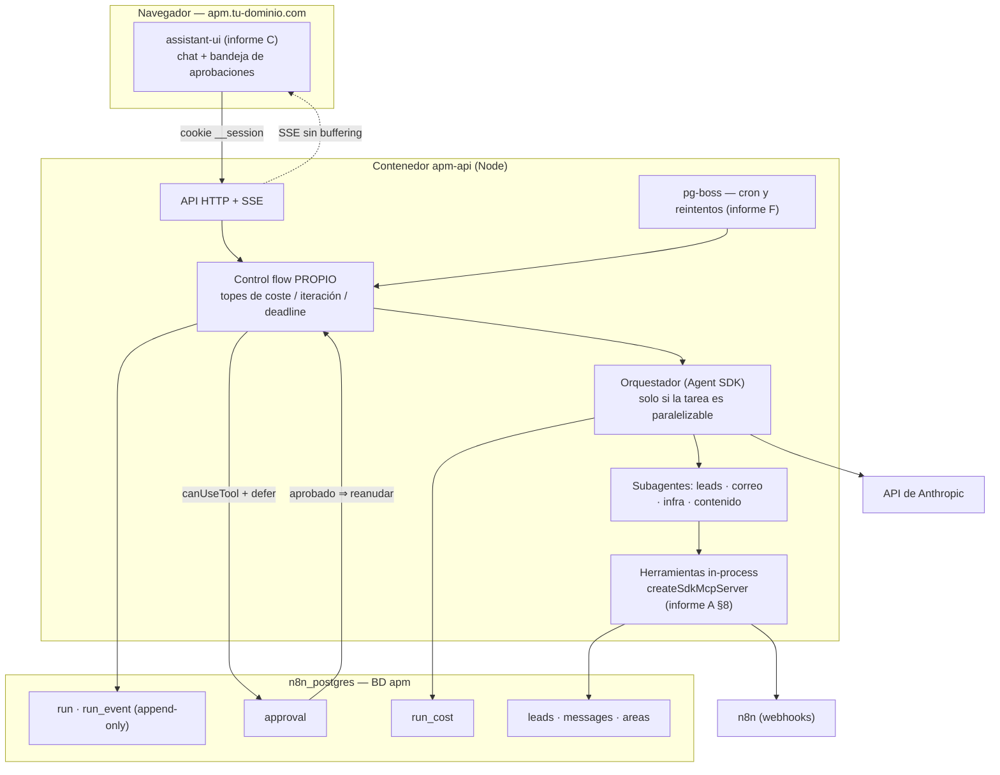

# Categoría B — Arquitecturas de referencia (mission control / orquestadores)

**Fecha de investigación:** 2 de agosto de 2026
**Pregunta que responde:** ¿cómo se estructura por dentro un "centro de mando" con agentes?
¿Qué patrón de orquestación copiamos, cómo se persisten las ejecuciones, cómo se aprueban
acciones sensibles y cómo se mide el coste — todo dentro de 2 núcleos y 4,6 GB libres?

**Todo lo marcado con ✅ está verificado contra la API de GitHub, el registry de npm o la
documentación oficial en esta fecha.** Lo marcado con ⚠️ NO VERIFICADO se señala explícitamente.

Depende de: `G-infra-real.md` (restricciones del host), `A-agent-sdk.md` (runtime de agentes),
`F-n8n-automatizaciones.md` (scheduler y SSE).

---

## 0. Recomendación en una línea

> **APM construye su propio control plane** (Node + Postgres + pg-boss, ya decidido en F),
> aplica el patrón **orquestador-worker de Anthropic** *solo* cuando la tarea es paralelizable,
> guarda cada ejecución como un **log de eventos append-only en Postgres** (factor 12), y
> **descarta toda la capa de observabilidad enlatada** (Langfuse, Helicone, Phoenix) por coste
> de RAM: el registro de coste vive en dos tablas nuestras con los nombres de atributo de
> **OpenTelemetry GenAI semconv**, para poder exportar a un colector el día que haga falta.

Lo que NO hay que construir: un framework de agentes (lo pone el Agent SDK), un motor de
durabilidad (Postgres + pg-boss llegan de sobra a esta escala) y una UI de chat (assistant-ui, informe C).

---

## 1. Tabla de fuentes verificadas

| Repo / fuente | ★ | Licencia | Último push | Qué aporta |
|---|---|---|---|---|
| `anthropic.com/engineering/multi-agent-research-system` | — | artículo oficial | — | El patrón orquestador-worker con números reales ✅ |
| `humanlayer/12-factor-agents` | **25.036** ✅ | NOASSERTION ⚠️ | **2025-09-21** (parado) ✅ | Los principios de control flow propio |
| `builderz-labs/mission-control` | **5.902** ✅ | MIT ✅ | 2026-07-27 ✅ | Control plane self-hosted ya hecho (alpha) |
| `dbos-inc/dbos-transact-ts` | 1.303 ✅ | MIT ✅ | 2026-07-30 ✅ | Durabilidad in-process sobre Postgres |
| `langchain-ai/agent-inbox` | 1.041 ✅ | MIT ✅ | 2026-07-27 ✅ | UX de bandeja para aprobaciones |
| `inngest/inngest` | 5.679 ✅ | NOASSERTION ⚠️ | 2026-08-02 ✅ | Durable execution como servicio |
| `restatedev/restate` | 4.240 ✅ | NOASSERTION ⚠️ | 2026-08-02 ✅ | Durable execution ligero (Rust) |
| `temporalio/sdk-typescript` | 890 ✅ | MIT ✅ | 2026-08-01 ✅ | Durabilidad de referencia a gran escala |
| `langfuse/langfuse` | **32.349** ✅ | NOASSERTION ⚠️ | 2026-08-01 ✅ | Observabilidad LLM (pesada) |
| `Arize-ai/phoenix` | 10.861 ✅ | NOASSERTION ⚠️ | 2026-08-02 ✅ | Observabilidad + evals |
| `Helicone/helicone` | 6.028 ✅ | Apache-2.0 ✅ | 2026-07-25 ✅ | Gateway de coste — **ver §7, está muerto** |
| `openlit/openlit` | 2.666 ✅ | Apache-2.0 ✅ | 2026-08-01 ✅ | Observabilidad OTel-nativa |

Versiones npm consultadas el 2-ago-2026 contra `registry.npmjs.org` ✅:

| Paquete | Versión | Publicado | Licencia | Deps directas |
|---|---|---|---|---|
| `@anthropic-ai/claude-agent-sdk` | 0.3.220 | 2026-07-24 | SEE LICENSE IN README ⚠️ | **0** |
| `pg-boss` | 12.26.4 | 2026-08-01 | MIT | **3** |
| `@dbos-inc/dbos-sdk` | 4.25.14 | 2026-07-30 | MIT | **6** |

---

## 2. El patrón de referencia: orquestador-worker (Anthropic)

Es la arquitectura del sistema de Research de Anthropic, y la única publicada con números
de producción. Resumen verificado del artículo oficial ✅:

- Un **agente líder** (Opus) analiza la petición, decide la estrategia y **lanza subagentes**
  (Sonnet) que trabajan **en paralelo**.
- Cada subagente recibe cuatro cosas obligatorias: **objetivo, formato de salida, guía de
  herramientas/fuentes y límites explícitos de la tarea**. Instrucciones cortas del tipo
  "investiga la escasez" producen trabajo duplicado entre subagentes.
- **Regla de escalado embebida en el prompt del líder**: consulta simple → 1 agente y 3-10
  llamadas; comparativa → 2-4 agentes con 10-15 llamadas cada uno; investigación compleja →
  10+ agentes con responsabilidades repartidas.
- El líder levanta **3-5 subagentes en paralelo**, y cada subagente usa **3+ herramientas en
  paralelo**. Esto recortó hasta un **90 % el tiempo** de las consultas complejas.
- **Memoria externa**: antes de llenar la ventana (200.000 tokens) el líder guarda el plan
  fuera del contexto; las salidas grandes de los subagentes van a un almacén externo y al
  coordinador solo vuelve una **referencia ligera**, no el contenido.
- **Agente de citas** dedicado: un paso posterior que recorre el informe y ata cada
  afirmación a su fuente. (Para APM esto se traduce en un subagente de verificación que ata
  cada lead a la URL de donde salió.)

### 2.1 El número que manda en el diseño: **15×**

| Modo | Consumo de tokens |
|---|---|
| Chat normal | 1× |
| Agente con herramientas | **~4×** |
| Sistema multi-agente | **~15×** |

Mejora medida: **+90,2 %** frente a un agente único en su evaluación interna de research. ✅

**Lectura para APM (esto es opinión mía, no del artículo):** el multiplicador 15× es
aceptable cuando el resultado se vende (una tanda de leads calificados) e inaceptable como
modo por defecto de la caja de chat. El artículo dice explícitamente que el multi-agente
**no compensa** cuando todos los agentes necesitan el mismo contexto, cuando hay muchas
interdependencias, o cuando el valor no justifica el coste.

→ **Decisión de diseño:** APM arranca **single-agent con herramientas** para todo, y el modo
orquestador se activa **solo** en tareas explícitamente paralelizables (barrido de leads en
N zonas, teardown de N competidores). El propio orquestador debe llevar un tope de
subagentes y de coste por ejecución (§5.3).

### 2.2 Lo que el artículo avisa sobre producción

- Los agentes son **con estado**: un fallo pequeño no se queda pequeño, muta el comportamiento.
- Hay que poder **reanudar desde el punto del error**, no reiniciar (caro y frustrante).
- Son **no deterministas** con el mismo prompt → sin trazas completas, depurar es imposible.
- **Rainbow deployments**: al desplegar, conviven versiones vieja y nueva para no cortar
  ejecuciones a medias. ⚠️ Para APM esto es exagerado hoy, pero implica una regla barata:
  **antes de `docker compose up --build`, no debe haber ejecuciones vivas** (o se marcan
  como interrumpidas y se reanudan). Esto va al runbook de despliegue.

---

## 3. Los 12 factores, filtrados a lo que nos aplica

`humanlayer/12-factor-agents` (25.036 ★) es la referencia más citada del sector, pero
⚠️ **su último push es de septiembre de 2025**: es un documento de principios, no una
dependencia. Los tres que cambian el diseño de APM:

1. **Factor 8 — dueño de tu control flow.** El bucle `while` es nuestro: nosotros decidimos
   cuándo reintenta, cuándo pausa, cuándo para. El modelo elige la *siguiente acción*, no el
   ciclo de vida. En la práctica: topes de iteración, de coste y de tiempo **en nuestro
   código**, nunca "confiando" en que el prompt lo respete.
2. **Factor 12 — el agente como reductor sin estado**: `f(eventos) -> siguiente acción`.
   El estado de verdad es el **log de eventos**, no la memoria del proceso. Esto es lo que
   nos permite reiniciar el contenedor sin perder nada.
3. **Contactar humanos es una herramienta más**, no un caso especial del framework.
   Encaja exactamente con `canUseTool` + `defer` del Agent SDK (informe A §6).

Es coherente con lo que ya elegimos en A y C. No aporta código; aporta la disciplina de
**no delegar en un framework lo que es negocio nuestro**.

---

## 4. ¿Y si adoptamos un control plane ya hecho? (build vs adopt honesto)

`builderz-labs/mission-control` — 5.902 ★, MIT, push 2026-07-27 ✅ — es literalmente
"control plane self-hosted para agentes: despachar tareas, revisar ejecuciones, controlar
gasto, operar Claude Code / Codex". Es la opción de "no construyas nada".

**A favor:** 32 paneles (tareas, agentes, skills, logs, memoria, seguridad, cron, alertas,
webhooks, pipelines), SQLite en WAL sin Postgres ni Redis, roles multi-usuario, agregación
de coste, aprobaciones, adaptadores para Claude Code/Codex/CrewAI/LangGraph, Docker.

**En contra — y por esto lo descarto:**

1. **Es un control plane *sobre* runtimes, no un runtime.** No ejecuta agentes: los agentes
   se registran, reclaman tareas de una cola y devuelven resultados ✅. APM necesita lo
   contrario: el agente corre **dentro** de nuestro backend con nuestras herramientas
   (leads, correo, n8n, la BD de tu empresa).
2. **Alpha declarada por los propios autores**: "APIs, esquemas y configuración pueden
   cambiar entre releases", y avisan de que **el control de acceso está incompleto** antes
   de exponerlo en red ✅. Sería la pieza más expuesta de la VPS.
3. **Ni una sola de las funciones de negocio de APM está ahí**: leads, bandeja de correo
   unificada, áreas, websites. Terminaríamos manteniendo su modelo de datos *y* el nuestro.
4. **Next.js 16 + pnpm + Node 22** ✅ = estrenar en la VPS un stack de build que hoy no existe
   (ver G.8), para un producto que no es el nuestro.

**Lo que sí robamos de ellos, gratis:** su taxonomía de paneles. Tasks / agents / runs /
schedules / alerts / webhooks / API keys / audit trail / cost views es exactamente el
inventario de pantallas que APM va a necesitar. Sirve de checklist, no de dependencia.

**Veredicto:** construir. Pero con una condición honesta — si dentro de tres meses APM se
ha convertido en "una cola de tareas con paneles", entonces me equivoqué y esto se revisa.

---

## 5. Durabilidad: qué pasa cuando el contenedor se reinicia a mitad de una ejecución

Este es el punto donde casi todos los proyectos de agentes se rompen. Cuatro niveles:

| Nivel | Qué sobrevive | Coste operativo | Veredicto para APM |
|---|---|---|---|
| **0 — nada** | El proceso muere, la ejecución se pierde | 0 | ❌ Inaceptable: hay aprobaciones que esperan horas |
| **1 — Postgres a mano** (log de eventos + `pg-boss` reintentando el job) | Ejecuciones, aprobaciones pendientes, coste | Casi 0 (Postgres y pg-boss ya están) | ✅ **Recomendado** |
| **2 — DBOS Transact** (durabilidad in-process sobre el mismo Postgres) | Además: el punto exacto del código donde se murió | Bajo: es **una librería**, no infraestructura ✅ | 🔶 Camino de ampliación |
| **3 — Temporal / Restate / Inngest** (servidor aparte) | Todo, a escala de miles de workflows | **Alto: proceso(s) nuevos + su propia BD** | ❌ Descartado (RAM) |

### 5.1 Por qué el nivel 3 está descartado aquí

Temporal, Restate e Inngest son excelentes y están muy vivos ✅ (push del 1-2 ago 2026),
pero los tres significan **servidor de orquestación aparte** en una VPS con 4,6 GB libres,
2 núcleos y 1 GB de swap ya en uso (G.1). Con el Agent SDK pidiendo ~1 GiB por agente como
**suelo** (informe A), gastar cientos de MB en un motor de workflows para un producto de
**un solo usuario** es una mala asignación de recursos. Se revisa si algún día APM ejecuta
workflows de varios pasos para clientes externos.

### 5.2 DBOS como camino de ampliación (no ahora)

`@dbos-inc/dbos-sdk` 4.25.14, MIT, **6 dependencias directas** ✅ — corre **dentro** del
proceso Node y guarda el estado de ejecución en **el Postgres que ya tenemos**. Es la única
opción de nivel 3 sin infraestructura nueva. ⚠️ NO VERIFICADO: no he leído su documentación
ni probado su convivencia con `pg-boss` en la misma BD, ni su comportamiento con procesos
de larga duración que esperan aprobación humana. **Anotado como spike futuro, no como
decisión.**

### 5.3 Lo que sí hacemos en Fase 2 (nivel 1, concreto)

```
run                     ← una ejecución de agente (estado: queued|running|awaiting_approval|done|failed|cancelled)
run_event               ← log append-only: cada mensaje, tool_use, tool_result, error
run_cost                ← tokens y dólares por turno (ver §7)
approval                ← petición pendiente, con TTL y el requestId del SDK
```

Reglas que se derivan de A + B, y que evitan los tres fallos clásicos:

- El log de eventos es **append-only**. Reconstruir el estado = releer eventos (factor 12).
- Cada `run` lleva **tope de coste, tope de iteraciones y `deadline`**. Al superarlos, para
  el bucle **nuestro código**, no el prompt.
- Al arrancar el proceso: todo `run` en `running` sin worker vivo pasa a `interrupted` y se
  reencola (esto es la versión barata del "rainbow deploy" de §2.2).
- Las aprobaciones sobreviven al reinicio porque viven en Postgres, no en memoria. ⚠️ El
  punto frágil sigue siendo el que ya identificó el informe A (riesgo 7): si el transcript
  del SDK está en disco local, el `defer` puede no sobrevivir. **Ese spike sigue siendo el
  primer trabajo técnico de la Fase 2.**

---

## 6. Aprobación humana: el patrón "bandeja", no el patrón "popup"

`langchain-ai/agent-inbox` (1.041 ★, MIT, push 2026-07-27 ✅) formaliza una idea que APM
debería copiar tal cual, **sin usar la librería** (es para LangGraph):

> Las aprobaciones no son diálogos modales dentro del chat. Son una **bandeja de entrada**
> con su propia URL, donde se acumulan las acciones que el agente quiere ejecutar y que
> esperan un humano.

El motivo es operativo, no estético: si la aprobación vive dentro de la sesión de chat,
cerrar la pestaña mata la acción. En bandeja, el agente puede pedir permiso el martes y
el dueño aprobarlo el miércoles desde el móvil.

En LangGraph el mecanismo es `interrupt` + checkpointer persistente (`AsyncPostgresSaver`) ✅.
En APM el equivalente exacto ya lo tenemos: **`canUseTool` + `defer` + fila en `approval`**
(informe A §6). Misma semántica, sin adoptar LangGraph.

**Regla dura, ya acordada en el brief:** ninguna acción destructiva o de envío al exterior
(correo, WhatsApp, borrado, gasto) se ejecuta sin fila aprobada. La aprobación se verifica
en el **servidor**; nunca se confía en que el prompt "recuerde" pedir permiso.

---

## 7. Observabilidad y coste: por qué NO instalamos una plataforma

Es la sección con la conclusión más contraintuitiva del informe.

| Opción | ★ | Estado | Por qué no |
|---|---|---|---|
| **Langfuse** | 32.349 ✅ | Vivo, es el estándar de facto | Exige **Postgres + ClickHouse + Redis + S3** además de web y worker ✅. Su propia doc recomienda "al menos 2 CPU y 4 GB **para los contenedores de aplicación**" ✅ — es decir, sin contar ClickHouse. **Eso es toda la RAM libre de la VPS para mirar gráficos.** ❌ |
| **Helicone** | 6.028 ✅ | ⚠️ **Adquirido por Mintlify (mar-2026); desarrollo detenido**, solo parches de seguridad (según búsqueda, NO verificado en fuente oficial) | Construir sobre algo sin roadmap ❌ |
| **Phoenix (Arize)** | 10.861 ✅ | Muy vivo (push 2026-08-02) | Orientado a evaluación/experimentación; otro servicio más en la VPS 🔶 |
| **OpenLIT** | 2.666 ✅ | Vivo, nativo OTel | Sigue siendo un stack de observabilidad completo 🔶 |
| **Tablas propias + semconv de OTel** | — | — | ✅ **Elegido** |

### 7.1 El estándar que sí adoptamos (gratis)

Las **GenAI semantic conventions de OpenTelemetry** definen los nombres canónicos:
spans `invoke_agent`, `chat`, `execute_tool`, atributos `gen_ai.request.model`,
`gen_ai.usage.input_tokens` (según búsqueda ✅). Estado: ⚠️ los spans de *cliente* salieron
de experimental a principios de 2026, pero **agentes y frameworks siguen siendo
experimentales**; en junio de 2026 (v1.42.0) los atributos `gen_ai.*` se movieron a un repo
propio — cambio organizativo, **no** graduación a estable. ⚠️ NO VERIFICADO contra la spec
oficial; viene de resultados de búsqueda.

**Consecuencia práctica y barata:** las columnas de nuestras tablas se llaman igual que los
atributos de la convención (`model`, `input_tokens`, `output_tokens`,
`cache_read_input_tokens`, `cache_creation_input_tokens`, `operation_name`). Coste hoy: cero.
Beneficio el día que queramos exportar a un colector: un `SELECT` en vez de una migración.

### 7.2 Qué medimos desde el día uno

El SDK ya devuelve el uso por turno (informe A §9). APM solo tiene que **persistirlo y
sumarlo**:

- Por `run`: tokens de entrada/salida, tokens de caché leídos y creados, coste en dólares,
  duración, nº de llamadas a herramientas, nº de subagentes.
- Por día y por área (marketing, ventas, infra…), para el **panel de presupuesto de tokens**
  que ya está en el PLAN (Fase 2).
- **Tope duro**: al superar el presupuesto diario, el orquestador se niega a lanzar
  subagentes nuevos. Con el multiplicador 15× de §2.1, esto no es una métrica bonita: es
  el freno de mano.

⚠️ Los precios por millón de tokens de cada modelo **no se hardcodean en el código**: van en
una tabla de configuración, porque cambian. (Los IDs de modelo exactos siguen pendientes de
confirmar, riesgo 2 del informe A.)

---

## 8. Arquitectura resultante para APM



**Presupuesto de RAM (estimación, ⚠️ a medir en el spike):**

| Componente | Estimado |
|---|---|
| `apm-api` en reposo (Node + Express + pg) | ~150-250 MB |
| Cada agente activo del SDK | **~1 GiB (suelo oficial, informe A)** |
| pg-boss | despreciable (usa el Postgres existente) |
| BD `apm` | despreciable al principio |
| **Total con 1 agente trabajando** | **~1,2 GB de los 4,6 GB libres** |

→ **Límite operativo derivado: 2 ejecuciones concurrentes como máximo**, con cola para el
resto. Con 3 agentes simultáneos entramos en swap, y la VPS ya tiene 1 GB de swap en uso.
Esto no es una recomendación: es una constante de configuración (`MAX_CONCURRENT_RUNS=2`)
que debe existir en el código desde el primer día.

---

## 9. ⚠️ Correcciones a supuestos previos

1. **"Multi-agente es mejor" — falso como regla general.** El propio artículo de Anthropic
   dice que el multi-agente no compensa cuando hay mucha interdependencia o contexto
   compartido, y que la mayoría de tareas de *código* tienen menos paralelismo real del que
   parece. APM debe ser single-agent por defecto.
2. **"Necesitamos Langfuse para ver el coste" — falso.** El Agent SDK ya devuelve el uso por
   turno; lo que falta es una tabla, no una plataforma. Langfuse costaría más RAM que el
   propio producto.
3. **"Durabilidad = Temporal" — falso a nuestra escala.** Para un solo usuario, un log de
   eventos en Postgres más los reintentos de pg-boss cubren el requisito real
   ("que un reinicio no pierda una aprobación pendiente").
4. **Helicone ya no es candidato** — ⚠️ adquirido y sin roadmap según la búsqueda; no
   verificado en fuente oficial, pero suficiente para no apostar por él.

---

## 10. Riesgos e incógnitas (NO VERIFICADO)

1. **⚠️ El spike de `SessionStore` + `defer` sigue sin hacerse** (riesgo 7 del informe A).
   Toda la arquitectura de aprobaciones de §5 y §6 depende de que una llamada diferida
   sobreviva al reinicio del contenedor. **Es el primer trabajo técnico de la Fase 2.**
2. **⚠️ Los ~1 GiB por agente son un suelo oficial, no una medición nuestra.** El límite de
   2 ejecuciones concurrentes puede quedarse en 1, o subir a 3. Hay que medirlo antes de
   prometer nada.
3. **⚠️ DBOS + pg-boss en la misma BD**: no verificado que convivan sin pelearse por
   esquemas o conexiones.
4. **⚠️ Estado real de la semconv GenAI de OTel**: tomado de resultados de búsqueda, no de
   la especificación. Solo afecta a nombres de columna, riesgo bajo.
5. **⚠️ Helicone/Mintlify**: adquisición no verificada en fuente primaria.
6. **⚠️ Requisitos de ClickHouse para Langfuse**: la cifra de "16 GiB recomendados" viene de
   búsqueda, no de la doc oficial. La cifra que **sí** está verificada en la doc de Langfuse
   es "al menos 2 CPU y 4 GB para los contenedores de aplicación" ✅ — y ya es suficiente
   para descartarlo.
7. **No he leído** la documentación de Inngest, Restate ni Temporal en profundidad: se
   descartan por **modelo de despliegue** (servidor aparte en una VPS llena), no por calidad.

---

## Fuentes

- [Anthropic — How we built our multi-agent research system](https://www.anthropic.com/engineering/multi-agent-research-system)
- [Claude — When to use multi-agent systems (and when not to)](https://claude.com/blog/building-multi-agent-systems-when-and-how-to-use-them)
- [humanlayer/12-factor-agents](https://github.com/humanlayer/12-factor-agents) · [12 Factor Agents — HumanLayer blog](https://www.humanlayer.dev/blog/12-factor-agents)
- [builderz-labs/mission-control](https://github.com/builderz-labs/mission-control) (README y API de GitHub)
- [langchain-ai/agent-inbox](https://github.com/langchain-ai/agent-inbox) · [LangChain — Human-in-the-loop](https://docs.langchain.com/oss/python/langchain/human-in-the-loop)
- [DBOS Transact](https://www.dbos.dev/dbos-transact) · [dbos-inc/dbos-transact-ts](https://github.com/dbos-inc/dbos-transact-ts)
- [Langfuse — Application containers (self-hosted)](https://langfuse.com/self-hosting/deployment/infrastructure/containers) · [Scaling Langfuse](https://langfuse.com/self-hosting/configuration/scaling)
- [Helicone — Cost tracking](https://docs.helicone.ai/guides/cookbooks/cost-tracking) · [Helicone/helicone](https://github.com/helicone/helicone)
- [OpenTelemetry for AI Systems (Uptrace)](https://uptrace.dev/blog/opentelemetry-ai-systems) · [GenAI semconv cheat sheet](https://techbytes.app/posts/opentelemetry-genai-agent-semconv-cheat-sheet-2026/)
- [Inngest — Durable execution for AI agents](https://www.inngest.com/blog/durable-execution-key-to-harnessing-ai-agents) · [Temporal vs Inngest (2026)](https://wetheflywheel.com/en/comparisons/temporal-vs-inngest/)
- API de GitHub y registry de npm (estrellas, licencias, fechas, versiones) — consultadas el 2-ago-2026
