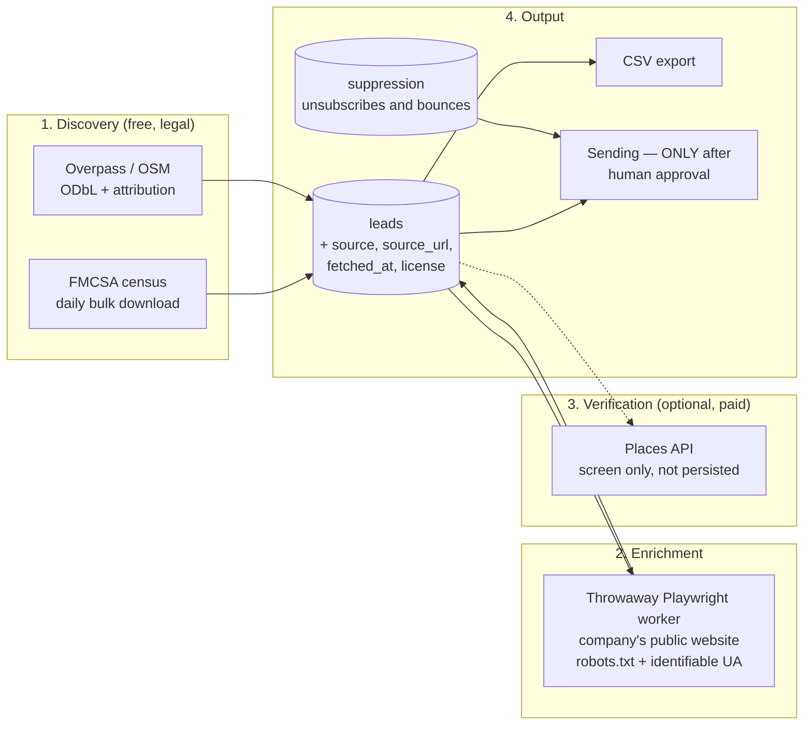

# Category D — Lead scrapers (companies + video) and legal/ToS analysis

**Research date:** August 2, 2026
**Question it answers:** where does APM get company and video leads from, how much does it
cost, what can legally be done, and what do the terms of service forbid?

**Everything marked ✅ is verified against the GitHub API, the official documentation or the
terms of service themselves on this date.** Anything ⚠️ NOT VERIFIED is flagged.

⚠️ **Upfront notice:** this is technical and terms-of-service research, **not legal advice**.
Before launching cold outreach campaigns, a review with a New Jersey lawyer is advisable.
The penalty figures are there to size the risk, not to reassure anyone.

Depends on: `G-infra-real.md` (RAM), `B-arquitecturas.md` (where the workers fit).

---

## 0. One-line recommendation

> **Discovery through free, open sources** (the public FMCSA census + OpenStreetMap),
> **enrichment by visiting each company's own website** (which is what is allowed),
> and **Google Places API only as a spot check, never as the CRM's origin** — because its
> policy forbids storing its content except the `place_id` ✅. For video, **YouTube Data API
> v3 only**, with 100 searches a day as a hard ceiling ✅, and **collecting personal data from
> YouTube is forbidden**: its terms say so literally ✅.

**And the finding that changes the plan the most:** this module's bottleneck **isn't getting
leads, it's contacting them**. CAN-SPAM fines up to **$53,088 per email** ⚠️ and requires a
**physical postal address** on every commercial send. That's a business decision for the
owner (a business mailbox, not the home address) that must be made **before** writing the
scraper.

---

## 1. The filter: two constraints that rule out almost everything

1. **RAM (G.1):** 4.6 GB free, 2 cores, 1 GB of swap already in use, and a Playwright
   container already running on the server.
2. **Legal:** APM isn't a niche scraper, it's the tool of a company **with a name and an
   address** in New Jersey. The "scrape and we'll see" strategy isn't viable when the
   potential defendant is a named business owner, not an anonymous user.

With those two filters, the scraping-platform comparison settles itself:

| Tool | ★ | License | RAM | Verdict |
|---|---|---|---|---|
| **Firecrawl** (self-host) | — ⚠️ (repo moved to `firecrawl/firecrawl`, not verified via API) | AGPL/SSPL ⚠️ | ⚠️ The upstream compose recommends **4 vCPU / 8 GB for `api`** + 2 vCPU / 4 GB for Playwright (per search) | ❌ **Impossible**: asks for more RAM than the whole VPS |
| **crawl4ai** | **75,865** ✅ | Apache-2.0 ✅ | ⚠️ ~300 MB at rest + a 2 GB image (per search) | 🔶 Possible, but a new Python stack on a Node VPS |
| **Playwright** directly | 93,843 ✅ | Apache-2.0 ✅ | High **only while running** | ✅ **Chosen**: it's the pattern already used elsewhere on the server |
| **Crawlee** (TS) | 25,158 ✅ | Apache-2.0 ✅ | Same as Playwright + queue management | 🔶 Consider if scraping grows |
| `gosom/google-maps-scraper` | 5,376 ✅ | MIT ✅ | Go, low usage | ⚠️ See §3.2 — the problem is legal, not technical |
| `yt-dlp` | **181,998** ✅ | Unlicense ✅ | Low | ❌ See §5.2 — ruled out by ToS |

**Adopted pattern:** a **throwaway** Playwright worker (starts, does the job, dies), launched
by `pg-boss` with concurrency 1. Never one more permanent browser; there's already one.

---

## 2. Company lead sources — comparison

| Source | Cost | Legality of storing it | Coverage of the logistics niche | Verdict |
|---|---|---|---|---|
| **FMCSA Company Census File** (public carrier census) | **$0** ✅ | **Public domain** — US government data ✅ | High for fleets with vehicles >10,001 lb GVWR | ✅ **Primary source** |
| **OpenStreetMap / Overpass** | **$0** ✅ | ODbL: commercial use allowed with attribution; ⚠️ **share-alike on derived databases** | Medium-low for delivery companies | ✅ Complement |
| **Google Places API (New)** | **$32 / 1,000** (Text Search Pro) ⚠️ | ❌ **Only `place_id` can be stored indefinitely** ✅ | High | 🔶 Verification only |
| Google Maps scraping (OSS) | $0 + proxies ($50-300/month ⚠️) | ⚠️ Gray area, see §3.2 | High | ❌ Ruled out |
| Outscraper / Apify / SerpApi | ⚠️ $1.50 – $14 / 1,000 (per search) | They shift the risk to a third party | High | 🔶 Paid plan B |
| Each company's own website | ~$0 (our Playwright) | ✅ Public site, logged out | The best for enrichment | ✅ **Enrichment layer** |

### 2.1 The finding: the FMCSA census

The Department of Transportation's **Company Census File** is a **bulk-downloadable, free,
public-domain file updated daily** (latest verified update: 26-Jul-2026 ✅). For each entity
with a USDOT number it contains: identification, business operation data, **address**,
equipment and drivers, authority types and insurance ✅. The "Entities with a USDOT Number"
sets are generated from a 24-h database and are usually on the portal before 12:00 EST ✅.

For a product that sells software to delivery companies, this is **exactly the list of
prospects, free and with no ToS restricting it**. It's infinitely better than scraping
Google Maps: more complete, more structured, includes the number of vehicles and drivers (that
is, **what fleet size we're dealing with = which price plan to offer**), and it's legal with
no caveats.

⚠️ **Its limit, and it matters:** only those with a USDOT number appear, mandatory from
**10,001 lb GVWR** in interstate commerce ✅. Typical DSP vans (Transit, ProMaster) are around
**8,550–11,030 lb** ⚠️, so **some DSPs will be there and some won't**. And a DSP that operates
**only with bicycles** — a case the owner knows first-hand — **will never show up** in that
census. Honest conclusion: the FMCSA census is a great source for van DSPs and last-mile
fleets, **not** for bike delivery. For that segment you have to go through OSM and the open
web. (Verified later: see `FASE3-fuente-leads.md` — in practice the census does not cover DSPs.)

### 2.2 Why Google Places API can't be the CRM's origin

Verified on the official Places API policies page ✅:

> "You must not pre-fetch, cache, or store Places API content beyond the allowed exceptions."

and

> "The **place ID**, used to uniquely identify a place, is **exempt from** the caching restrictions."

Translated to our case: **the name, address and phone Places returns can't be saved in the
`leads` table** beyond the allowed exceptions. The only thing we can keep forever is an opaque
identifier that, on its own, doesn't let you contact anyone. ⚠️ The specific "30 days" figure
for coordinates comes from search results and the *Service Specific Terms*, which **I couldn't
download** (the request returned empty content) — **it stays NOT VERIFIED**.

On top of that, the price makes the rest of the argument: **$32 per 1,000 text searches on the
Pro tier** ⚠️ (per search; the "Essentials/IDs Only" tier is free but **only returns
identifiers**, no name or address ✅ — i.e. the free part is exactly the part useless for leads).

→ **Allowed use in APM:** spot-check that a company we already have from another source still
exists, showing it on screen with its attribution, without persisting the content. Nothing more.

---

## 3. The legal framework in the US (2026)

### 3.1 What the cases say

- **Van Buren (Supreme Court)** + **hiQ v. LinkedIn**: scraping **public** data doesn't violate
  the CFAA when no authentication barrier is bypassed ✅.
- **But hiQ lost the war**: in November 2022 the court found **breach of LinkedIn's user
  agreement**, which hiQ had accepted when creating accounts ✅.
- **Meta v. Bright Data (January 2024)**: the court found **no** breach for scraping public
  Facebook and Instagram pages **without logging in**, because the terms bind account
  holders, not a logged-out visitor. Meta dropped the suit in February 2024 ✅.

**The rule that emerges, which APM adopts as an internal norm:**

> Public scraping **without logging in** = defensible.
> Scraping **while logged in** against terms you accepted = indefensible.
> The CFAA protects you from "hacking"; **it doesn't protect you from a contract you signed**.

### 3.2 Applied to Google Maps

Here the rule above **doesn't save us**, because of a nuance worth understanding: to use the
**API** you have to accept its terms → you're inside the contract. And to scrape the Google
Maps **website** logged out, you enter the zone Meta v. Bright Data makes defensible… but
Google isn't Meta, the Maps frontend changes without notice ⚠️, and a pool of residential
proxies (⚠️ $50-300/month per search) would be needed to sustain it.

**Cost/benefit: terrible.** Paying for proxies and perpetual maintenance to get worse data
than a free government file, taking legal risk, with the company's real name behind it.
**Ruled out**, and `gosom/google-maps-scraper` (5,376 ★, MIT, technically very solid ✅) goes
with it. (Phase 3 later revisited this for gentle, internal-only use — see
`api/sources/google-maps.js` for the limits attached to that decision.)

### 3.3 Internal scraping rules for APM

These rules go into the code, not into a document nobody reads:

1. **Never log in** to a third-party site to extract data.
2. **Always respect `robots.txt`.** Even if it isn't binding on its own, ignoring it is the
   first thing a plaintiff points out.
3. **An identifiable User-Agent** (`MyBot/1.0 (+https://your-domain.com/bot)`) and a contact
   email. Hiding is what turns a scraper into "unauthorized access" in a judge's eyes.
4. **A conservative per-domain rate limit** (1 request every 2-5 s) and respect for
   `429`/`503` with backoff.
5. **Business data, not personal data.** The business's generic phone and email (`info@`,
   `contact@`), never employees' personal emails or anything resembling a profile.
6. **Mandatory provenance**: each `leads` row stores `source`, `source_url`, `fetched_at` and
   `license`. If one day everything from a source must be deleted, it's a `DELETE`, not
   archaeology.

---

## 4. The real bottleneck: contacting, not finding

This is what I least expected to find and what most affects the business plan.

**CAN-SPAM** (US) does allow cold commercial email **without prior consent**, unlike the GDPR
or Canada's CASL ⚠️. But it requires, on **every** commercial send:

1. Truthful headers and sender.
2. A non-deceptive subject.
3. Identifying the message as an ad.
4. **A valid physical postal address.**
5. An unsubscribe mechanism **that works**.
6. Processing unsubscribes in **≤ 30 calendar days** ⚠️.
7. Answering for what the vendors you hire do.

**Penalty: up to $53,088 per individual email** ⚠️ (per search, FTC 2026 inflation
adjustment) — **per email, not per campaign**. A badly sent list of 500 leads isn't a scare,
it's existential.

### 4.1 Two decisions the owner must make before writing code

1. **Which postal address goes in the email footer?** The company is a sole proprietorship
   based at the owner's home. Putting the home address on thousands of commercial emails is
   legal, but it means publishing the family home. **Recommendation: get a business mailbox
   (a USPS-registered CMRA) or a PO Box** — both count as a valid physical address ⚠️. Low
   cost, and it avoids something that can't be undone.
2. **Contact Europe?** If a lead is based in the EU, the GDPR applies and **the game changes
   completely** (consent, legal basis, data subject rights). Recommendation: **a country
   filter on the `leads` table; the sending module refuses to contact anyone outside the US**
   until there's an explicit decision about it.

### 4.2 Technical consequence

APM's sending module needs, from day one and **before** the first email goes out: a
**suppression** table (unsubscribes + bounces, permanent and checked on every send), a footer
with the physical address and unsubscribe link injected by the **server** (not by the agent's
prompt), a log of every send with its `message_id`, and **mandatory human approval** for any
bulk send (§6 of report B). An agent never sends commercial email on its own. Ever.

---

## 5. Video leads (YouTube)

### 5.1 The official route: YouTube Data API v3

- Default quota: **10,000 units/day per project** ✅.
- A **search call costs 100 units** → **100 searches a day and that's it** ✅. Simple reads
  cost 1 unit ✅.
- **You can't pay for more quota**: it's only requested through the audit and extension form,
  with a review taking weeks to months ⚠️.
- **No monetary cost per call** ✅ — the quota is the only restriction.

**Design forced by the quota:** searches (100 units) are the scarce resource; details (1 unit)
are almost free. → The worker does **few broad searches** and then many cheap reads, with
**aggressive caching** in Postgres and dedup by `channel_id`. A daily quota counter in the DB
that **blocks** at ~9,000 units, so we don't run out of API mid-morning.

### 5.2 Why `yt-dlp` is ruled out despite its 181,998 ★

YouTube's terms of service, **quoted verbatim** ✅:

> "access the Service using any automated means (such as robots, botnets or scrapers) except
> (a) in the case of public search engines, in accordance with YouTube's robots.txt file; or
> (b) with YouTube's prior written permission"

and, even more directly for a lead module:

> "collect or harvest any information that might identify a person (for example, usernames or
> faces), unless permitted by that person"

We're not a public search engine and we have no written permission. And "collecting
information that might identify a person" **is the literal definition of a lead scraper**.
→ `yt-dlp` is out, and **scraping comments to extract contacts is out too**, even through the
official API.

### 5.3 What APM CAN do with video

Discovery of **channels and content**, not people: what's published about running a DSP,
which competitors appear, which questions operators keep asking. That feeds the content engine
(which already exists in n8n) and market research. **The "lead" that comes out of YouTube is a
topic or a company, not an individual.**

⚠️ NOT VERIFIED: YouTube's *Developer Policies* (a separate document from the ToS I did read)
reportedly impose a ~30-day limit on storing API data before refreshing or deleting it. **I
couldn't confirm it at the source.** That document must be read before designing the YouTube
cache table.

---

## 6. Lead module architecture

**Estimated monthly cost of this architecture: $0** in data sources. All the spend goes to
tokens for the agent that classifies and drafts. Compare with the ~$14/1,000 leads of
commercial platforms ⚠️, or Places' $32/1,000 ⚠️.

**RAM:** the Playwright worker is throwaway with concurrency 1 → a peak of ~300-500 MB while
running ⚠️ (to be measured), zero at rest. Compatible with the 2-concurrent-runs limit set in
report B.

---

## 7. Implementation plan (Phase 3 of the PLAN)

1. **FMCSA census download** → `leads` table filtered by state and fleet size. No browser, no
   proxies, no legal risk. It's 80% of the value for 5% of the effort.
2. **Pipeline** `new → qualified → contacted → customer` + a suppression table from day one
   (not "later").
3. **Enrichment** with throwaway Playwright on each company's own website.
4. **Filterable table + CSV export** (this is already UI).
5. **Conversational trigger**: "find me DSPs in New Jersey with 20-50 vans" → parameters → run.
   This is where the agent adds value, not in the scraping.
6. **YouTube** at the end, with a quota counter, and only for topics/companies.
7. **Sending**: last, with the postal address decided, a working unsubscribe and human approval.

---

## 8. ⚠️ Corrections to earlier assumptions

1. **The PLAN's "Company scraper (Google Maps)" — changes source.** The Phase 3 PLAN says
   literally "Company scraper (Google Maps) end-to-end". The research says it's the worst of the
   available options: more expensive, more fragile and riskier legally than the public FMCSA
   census. **I propose changing that PLAN line** to "FMCSA census importer + web enrichment".
   The owner's call.
2. **"Scraping is the problem" — false.** The problem is CAN-SPAM-compliant **sending** and the
   postal address. Getting 5,000 leads is a `curl`; emailing them without exposure to $53,088
   per message requires infrastructure and a business decision.
3. **Firecrawl was on the brief's candidate list — it's impossible here.** Its own compose asks
   for more RAM than the whole VPS ⚠️.

---

## 9. Risks and unknowns (NOT VERIFIED)

1. **⚠️ Real DSP coverage in the FMCSA census.** I know the threshold is 10,001 lb GVWR ✅ and
   that vans hover around that figure ⚠️, but **I haven't downloaded the file or counted how
   many real DSPs appear**. It's the first thing to check in Phase 3 — and it's cheap: download,
   filter by NJ/NY, count.
2. **⚠️ The exact structure and fields of the FMCSA file**: not downloaded.
3. **⚠️ Google Maps Platform's specific terms**: the *Service Specific Terms* page returned
   empty content. The `place_id` rule and the caching ban **are** verified on the policies page
   ✅; the 30-day period for coordinates **is not**.
4. **⚠️ Places API prices**: from search results, not the official pricing page.
5. **⚠️ YouTube's Developer Policies** (§5.3): unread. They affect the cache design.
6. **⚠️ The $53,088 CAN-SPAM penalty**: from search, not the FTC source. The magnitude is right;
   the exact figure must be confirmed.
7. **⚠️ ODbL share-alike**: if we mix OSM into the `leads` table, does that table become subject
   to the ODbL as a derived database? A real, unanswered question. **Prudent mitigation: keep
   OSM data in a separate table** and don't merge it into the CRM until it's clarified.
8. **⚠️ Real RAM use of the Playwright worker**: an estimate, not a measurement.
9. **This is not legal advice.** A professional review before the first campaign.

---

## Sources

- [FMCSA — Data dissemination program](https://www.fmcsa.dot.gov/registration/fmcsa-data-dissemination-program) · [Company Census File (data.gov)](https://catalog.data.gov/dataset/company-census-file) · [Do I need a USDOT number?](https://www.fmcsa.dot.gov/registration/do-i-need-usdot-number)
- [Google — Places API policies](https://developers.google.com/maps/documentation/places/web-service/policies) · [Usage and billing](https://developers.google.com/maps/documentation/places/web-service/usage-and-billing) · [Service Specific Terms](https://cloud.google.com/maps-platform/terms/maps-service-terms) (not downloadable in this session)
- [YouTube — Terms of service](https://www.youtube.com/t/terms) · [YouTube API terms](https://developers.google.com/youtube/terms/api-services-terms-of-service)
- [Farella Braun + Martel — What hiQ v. LinkedIn and other cases say about the legality of scraping](https://www.fbm.com/publications/what-recent-rulings-in-hiq-v-linkedin-and-other-cases-say-about-the-legality-of-data-scraping/) · [Is web scraping legal? (Apify)](https://use-apify.com/docs/what-is-apify/is-apify-legal)
- [OpenStreetMap — Overpass API](https://wiki.openstreetmap.org/wiki/Overpass_API) · [API usage policy (OSMF)](https://operations.osmfoundation.org/policies/api/)
- CAN-SPAM: [2026 compliance guide](https://prospeo.io/s/can-spam-act-email-marketing) · [Physical address requirement](https://tomba.io/blog/can-spam-physical-address-requirement) · [Penalties](https://tomba.io/blog/can-spam-penalties)
- [gosom/google-maps-scraper](https://github.com/gosom/google-maps-scraper) · [unclecode/crawl4ai](https://github.com/unclecode/crawl4ai) · [apify/crawlee](https://github.com/apify/crawlee) · [yt-dlp](https://github.com/yt-dlp/yt-dlp)
- [Firecrawl — SELF_HOST.md](https://github.com/firecrawl/firecrawl/blob/main/SELF_HOST.md) · [Firecrawl vs Crawl4AI benchmark](https://fastcrw.com/blog/firecrawl-vs-crawl4ai-vs-crw)
- GitHub API (stars, licenses, dates) — checked on 2-Aug-2026
