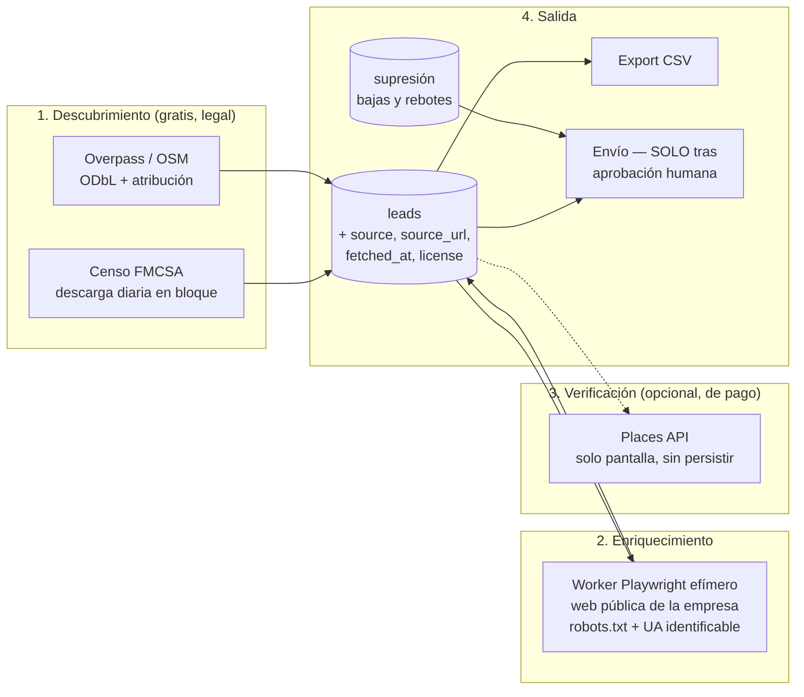

# Categoría D — Scrapers de leads (empresas + video) y análisis legal/ToS

**Fecha de investigación:** 2 de agosto de 2026
**Pregunta que responde:** ¿de dónde saca APM los leads de empresas y de video, cuánto cuesta,
qué se puede hacer legalmente y qué nos prohíben los términos de servicio?

**Todo lo marcado con ✅ está verificado contra la API de GitHub, la documentación oficial o
los propios términos de servicio en esta fecha.** Lo marcado con ⚠️ NO VERIFICADO se señala.

⚠️ **Aviso previo:** esto es investigación técnica y de términos de servicio, **no asesoría
legal**. Antes de lanzar campañas de contacto en frío conviene una revisión con un abogado
de Nueva Jersey. Las cifras de sanciones están para dimensionar el riesgo, no para
tranquilizar a nadie.

Depende de: `G-infra-real.md` (RAM), `B-arquitecturas.md` (dónde encajan los workers).

---

## 0. Recomendación en una línea

> **Descubrimiento por fuentes abiertas y gratuitas** (censo público de la FMCSA + OpenStreetMap),
> **enriquecimiento visitando la web propia de cada empresa** (que es lo que sí está permitido),
> y **Google Places API solo como verificación puntual, nunca como origen del CRM** — porque su
> política prohíbe almacenar su contenido salvo el `place_id` ✅. Para video, **YouTube Data API
> v3 exclusivamente**, con 100 búsquedas al día como techo duro ✅, y **prohibido recolectar
> datos de personas** de YouTube: sus términos lo dicen literalmente ✅.

**Y el hallazgo que más cambia el plan:** el cuello de botella de este módulo **no es
conseguir leads, es contactarlos**. CAN-SPAM sanciona hasta **$53.088 por correo** ⚠️ y exige
una **dirección postal física** en cada envío comercial. Eso es una decisión de negocio de
el dueño (buzón comercial, no la casa) que hay que tomar **antes** de escribir el scraper.

---

## 1. El filtro: dos restricciones que descartan casi todo

1. **RAM (G.1):** 4,6 GB libres, 2 núcleos, 1 GB de swap ya en uso, y un contenedor Playwright
   ya corriendo (`fleet-login-agent`).
2. **Legal:** APM no es un scraper de nicho, es la herramienta de una empresa **con nombre y
   dirección** en Nueva Jersey. La estrategia "raspa y ya veremos" no es viable cuando el
   demandado potencial es el dueño, no un usuario anónimo.

Con esos dos filtros, la comparativa de plataformas de scraping se resuelve sola:

| Herramienta | ★ | Licencia | RAM | Veredicto |
|---|---|---|---|---|
| **Firecrawl** (self-host) | — ⚠️ (repo movido a `firecrawl/firecrawl`, no verificado por API) | AGPL/SSPL ⚠️ | ⚠️ El compose upstream recomienda **4 vCPU / 8 GB para `api`** + 2 vCPU / 4 GB para Playwright (según búsqueda) | ❌ **Imposible**: pide más RAM que toda la VPS |
| **crawl4ai** | **75.865** ✅ | Apache-2.0 ✅ | ⚠️ ~300 MB en reposo + imagen de 2 GB (según búsqueda) | 🔶 Posible, pero es un stack Python nuevo en una VPS de Node |
| **Playwright** directo | 93.843 ✅ | Apache-2.0 ✅ | Alto **solo mientras corre** | ✅ **Elegido**: es el patrón que ya usas en Fleet |
| **Crawlee** (TS) | 25.158 ✅ | Apache-2.0 ✅ | Igual que Playwright + gestión de colas | 🔶 Considerar si el scraping crece |
| `gosom/google-maps-scraper` | 5.376 ✅ | MIT ✅ | Go, bajo consumo | ⚠️ Ver §3.2 — el problema es legal, no técnico |
| `yt-dlp` | **181.998** ✅ | Unlicense ✅ | Bajo | ❌ Ver §5.2 — descartado por ToS |

**Patrón adoptado:** worker **efímero** de Playwright (arranca, hace el trabajo, muere),
lanzado por `pg-boss` con concurrencia 1. Nunca un navegador permanente más, ya hay uno.

---

## 2. Fuentes de leads de empresas — comparativa

| Fuente | Coste | Legalidad de almacenarlo | Cobertura del nicho logística | Veredicto |
|---|---|---|---|---|
| **FMCSA Company Census File** (censo público de transportistas) | **$0** ✅ | **Dominio público** — dato del gobierno de EE. UU. ✅ | Alta para flotas con vehículos >10.001 lb GVWR | ✅ **Fuente primaria** |
| **OpenStreetMap / Overpass** | **$0** ✅ | ODbL: uso comercial permitido con atribución; ⚠️ **share-alike sobre bases derivadas** | Media-baja para empresas de reparto | ✅ Complemento |
| **Google Places API (New)** | **$32 / 1.000** (Text Search Pro) ⚠️ | ❌ **Solo `place_id` almacenable indefinidamente** ✅ | Alta | 🔶 Solo verificación |
| Scraping de Google Maps (OSS) | $0 + proxies ($50-300/mes ⚠️) | ⚠️ Zona gris, ver §3.2 | Alta | ❌ Descartado |
| Outscraper / Apify / SerpApi | ⚠️ $1,50 – $14 / 1.000 (según búsqueda) | Trasladan el riesgo a un tercero | Alta | 🔶 Plan B de pago |
| Web propia de cada empresa | ~$0 (nuestro Playwright) | ✅ Sitio público, logged-out | La mejor para enriquecer | ✅ **Capa de enriquecimiento** |

### 2.1 El hallazgo: el censo de la FMCSA

El **Company Census File** del Departamento de Transporte es un fichero **descargable en
bloque, gratuito, de dominio público y actualizado a diario** (última actualización
verificada: 26-jul-2026 ✅). Contiene, por cada entidad con número USDOT: identificación,
datos de operación del negocio, **dirección**, equipos y conductores, tipos de autoridad y
seguros ✅. Los conjuntos "Entities with a USDOT Number" se generan de una base de 24 h y
suelen estar en el portal antes de las 12:00 EST ✅.

Para un producto que vende software a empresas de reparto, esto es **exactamente la lista de
clientes potenciales, gratis y sin ToS que la restrinja**. Es infinitamente mejor que raspar
Google Maps: es más completo, más estructurado, incluye número de vehículos y conductores
(o sea, **con qué tamaño de flota tratamos = qué plan de precio ofrecer**), y es legal sin
matices.

⚠️ **Su límite, y es importante:** solo aparecen quienes tienen número USDOT, obligatorio a
partir de **10.001 lb de GVWR** en comercio interestatal ✅. Las furgonetas típicas de DSP
(Transit, ProMaster) rondan **8.550–11.030 lb** ⚠️, así que **una parte de los DSP estará y
otra no**. Y el caso que el dueño conoce de primera mano —un DSP que opera **solo con
bicicletas**— **no aparecerá jamás** en ese censo. Conclusión honesta: el censo de la FMCSA
es una gran fuente para DSP de furgoneta y flotas de última milla, **no** para reparto en
bici. Para ese segmento hay que ir por OSM y por la web abierta.

### 2.2 Por qué Google Places API no puede ser el origen del CRM

Verificado en la página oficial de políticas de la Places API ✅:

> "You must not pre-fetch, cache, or store Places API content beyond the allowed exceptions."

y

> "The **place ID**, used to uniquely identify a place, is **exempt from** the caching restrictions."

Traducido a nuestro caso: **el nombre, la dirección y el teléfono que devuelve Places no se
pueden guardar en la tabla `leads`** más allá de las excepciones permitidas. Lo único que
podemos guardar para siempre es un identificador opaco que, por sí solo, no sirve para
contactar a nadie. ⚠️ La cifra concreta de "30 días" para las coordenadas viene de resultados
de búsqueda y de los *Service Specific Terms*, que **no pude descargar** (la petición devolvió
contenido vacío) — **queda como NO VERIFICADO**.

Además, el precio hace el resto del argumento: **$32 por cada 1.000 búsquedas de texto en el
nivel Pro** ⚠️ (según búsqueda; el nivel "Essentials/IDs Only" es gratis pero **solo devuelve
identificadores**, ni nombre ni dirección ✅ — es decir, lo gratis es justo lo inútil para leads).

→ **Uso permitido en APM:** verificar puntualmente que una empresa que ya tenemos por otra vía
sigue existiendo, mostrándolo en pantalla con su atribución, sin persistir el contenido.
Nada más.

---

## 3. El marco legal en EE. UU. (2026)

### 3.1 Lo que dicen los casos

- **Van Buren (Supremo)** + **hiQ v. LinkedIn**: raspar datos **públicos** no infringe la
  CFAA cuando no se salta ninguna barrera de autenticación ✅.
- **Pero hiQ perdió la guerra**: en noviembre de 2022 el tribunal apreció **incumplimiento
  del contrato de usuario** de LinkedIn, que hiQ había aceptado al crear cuentas ✅.
- **Meta v. Bright Data (enero 2024)**: el tribunal **no** apreció incumplimiento por raspar
  páginas públicas de Facebook e Instagram **sin iniciar sesión**, porque los términos obligan
  a los titulares de cuenta, no a un visitante deslogueado. Meta retiró la demanda en febrero
  de 2024 ✅.

**La regla que emerge, y que APM adopta como norma interna:**

> Raspado público **sin iniciar sesión** = defendible.
> Raspado **con sesión iniciada** contra unos términos que aceptaste = indefendible.
> La CFAA te protege del "hackeo"; **no te protege de un contrato que firmaste**.

### 3.2 Aplicado a Google Maps

Aquí la regla anterior **no nos salva**, por un matiz que conviene entender: para usar la
**API** hay que aceptar sus términos → estás dentro del contrato. Y para raspar la **web** de
Google Maps sin sesión, entras en la zona que Meta v. Bright Data hace defendible… pero
Google no es Meta, el frontend de Maps cambia sin previo aviso ⚠️, y haría falta un parque de
proxies residenciales (⚠️ $50-300/mes según búsqueda) para sostenerlo.

**Coste/beneficio: pésimo.** Pagar proxies y mantenimiento perpetuo para obtener peores datos
que un fichero gubernamental gratuito, asumiendo riesgo legal, con el nombre real de la
empresa detrás. **Descartado**, y `gosom/google-maps-scraper` (5.376 ★, MIT, muy digno
técnicamente ✅) se descarta con él.

### 3.3 Reglas internas de scraping para APM

Estas reglas van al código, no a un documento que nadie lee:

1. **Nunca iniciar sesión** en un sitio de terceros para extraer datos.
2. **Respetar `robots.txt`** siempre. Aunque no sea vinculante por sí solo, ignorarlo es lo
   primero que enseña un demandante.
3. **User-Agent identificable** (`MiBot/1.0 (+https://tu-dominio.com/bot)`) y un correo de
   contacto. Esconderse es lo que convierte un scraper en "acceso no autorizado" a ojos de
   un juez.
4. **Rate limit conservador** por dominio (1 petición cada 2-5 s) y respeto de `429`/`503`
   con backoff.
5. **Datos de empresa, no de persona.** Teléfono y correo genéricos del negocio
   (`info@`, `contact@`), nunca correos personales de empleados ni nada que huela a perfil.
6. **Procedencia obligatoria**: cada fila de `leads` guarda `source`, `source_url`,
   `fetched_at` y `license`. Si un día hay que borrar todo lo de una fuente, es un `DELETE`,
   no una arqueología.

---

## 4. El cuello de botella real: contactar, no encontrar

Esto es lo que menos esperaba encontrar y lo que más afecta al plan de negocio.

**CAN-SPAM** (EE. UU.) sí permite el correo comercial en frío **sin consentimiento previo**,
a diferencia del RGPD o la CASL canadiense ⚠️. Pero exige, en **cada** envío comercial:

1. Encabezados y remitente veraces.
2. Asunto no engañoso.
3. Identificar el mensaje como publicidad.
4. **Una dirección postal física válida.**
5. Un mecanismo de baja **que funcione**.
6. Procesar las bajas en **≤ 30 días naturales** ⚠️.
7. Responder por lo que hagan los proveedores que contrates.

**Sanción: hasta $53.088 por correo individual** ⚠️ (según búsqueda, ajuste por inflación de
la FTC 2026) — **por correo, no por campaña**. Una lista de 500 leads mal enviada no es un
susto, es existencial.

### 4.1 Dos decisiones que el dueño tiene que tomar antes de escribir código

1. **¿Qué dirección postal va en el pie de los correos?** tu empresa es una empresa
   individual con sede en la casa del dueño. Poner la dirección de casa en miles de
   correos comerciales es legal, pero es publicar el domicilio familiar. **Recomendación:
   contratar un buzón comercial (CMRA registrada en USPS) o un apartado de correos** — ambos
   cuentan como dirección física válida ⚠️. Coste bajo, y evita algo que no tiene marcha atrás.
2. **¿Se contacta a Europa?** Si un lead tiene sede en la UE, entra el RGPD y **el juego
   cambia por completo** (consentimiento, base legal, derechos del interesado). Recomendación:
   **filtro de país en la tabla `leads`; el módulo de envío se niega a contactar fuera de
   EE. UU.** hasta que exista una decisión explícita al respecto.

### 4.2 Consecuencia técnica

El módulo de envío de APM necesita, desde el día uno y **antes** de mandar el primer correo:
tabla de **supresión** (bajas + rebotes, permanente y consultada en cada envío), pie con
dirección física e enlace de baja inyectados por el **servidor** (no por el prompt del
agente), registro de cada envío con su `message_id`, y **aprobación humana obligatoria** para
cualquier envío masivo (§6 del informe B). Un agente no envía correo comercial solo. Nunca.

---

## 5. Leads de video (YouTube)

### 5.1 La vía oficial: YouTube Data API v3

- Cuota por defecto: **10.000 unidades/día por proyecto** ✅.
- Una llamada de **búsqueda cuesta 100 unidades** → **100 búsquedas al día y se acabó** ✅.
  Las lecturas simples cuestan 1 unidad ✅.
- **No se puede pagar por más cuota**: solo se pide por el formulario de auditoría y
  extensión, con revisión de semanas a meses ⚠️.
- **No hay coste monetario por llamada** ✅ — la cuota es la única restricción.

**Diseño obligado por la cuota:** las búsquedas (100 unidades) son el recurso escaso; los
detalles (1 unidad) son casi gratis. → El worker hace **pocas búsquedas amplias** y luego
muchas lecturas baratas, con **caché agresiva** en Postgres y deduplicación por `channel_id`.
Un contador de cuota diario en la BD que **bloquea** al llegar a ~9.000 unidades, para no
quedarnos sin API a media mañana.

### 5.2 Por qué `yt-dlp` queda descartado pese a sus 181.998 ★

Términos de servicio de YouTube, **citados textualmente** ✅:

> "access the Service using any automated means (such as robots, botnets or scrapers) except
> (a) in the case of public search engines, in accordance with YouTube's robots.txt file; or
> (b) with YouTube's prior written permission"

y, aún más directo para un módulo de leads:

> "collect or harvest any information that might identify a person (for example, usernames or
> faces), unless permitted by that person"

No somos un buscador público y no tenemos permiso escrito. Y "recolectar información que
pueda identificar a una persona" **es la definición literal de un scraper de leads**.
→ `yt-dlp` fuera, y **raspar comentarios para sacar contactos, fuera también**, aunque se
haga con la API oficial.

### 5.3 Qué SÍ puede hacer APM con video

Descubrimiento de **canales y contenido**, no de personas: qué se publica sobre gestión de
DSP, qué competidores aparecen, qué preguntas repiten los operadores. Eso alimenta el motor
de contenido (que ya existe en n8n) y la investigación de mercado. **El "lead" que sale de
YouTube es un tema o una empresa, no un individuo.**

⚠️ NO VERIFICADO: los *Developer Policies* de YouTube (documento aparte de los ToS que sí leí)
imponen, según se comenta habitualmente, un límite de ~30 días para almacenar datos de la API
antes de refrescarlos o borrarlos. **No pude confirmarlo en la fuente.** Antes de diseñar la
tabla de caché de YouTube hay que leer ese documento.

---

## 6. Arquitectura del módulo de leads

**Coste mensual estimado de esta arquitectura: $0** en fuentes de datos. Todo el gasto se va
a tokens del agente que clasifica y redacta. Compárese con los ~$14/1.000 leads de las
plataformas comerciales ⚠️, o con los $32/1.000 de Places ⚠️.

**RAM:** el worker de Playwright es efímero y con concurrencia 1 → pico de ~300-500 MB
mientras corre ⚠️ (a medir), cero en reposo. Compatible con el límite de 2 ejecuciones
concurrentes fijado en el informe B.

---

## 7. Plan de implementación (Fase 3 del PLAN)

1. **Descarga del censo FMCSA** → tabla `leads` con filtro por estado y tamaño de flota.
   Sin navegador, sin proxies, sin riesgo legal. Es el 80 % del valor por el 5 % del esfuerzo.
2. **Pipeline** `nuevo → calificado → contactado → cliente` + tabla de supresión desde el
   primer día (no "después").
3. **Enriquecimiento** con Playwright efímero sobre la web propia de cada empresa.
4. **Tabla filtrable + export CSV** (esto ya es UI).
5. **Disparo conversacional**: "búscame DSP en Nueva Jersey con 20-50 furgonetas" → parámetros
   → ejecución. Aquí es donde el agente aporta, no en el scraping.
6. **YouTube** al final, con contador de cuota, y solo para temas/empresas.
7. **Envío**: lo último, con dirección postal decidida, baja funcionando y aprobación humana.

---

## 8. ⚠️ Correcciones a supuestos previos

1. **"Scraper de empresas (Google Maps)" del PLAN — cambia de fuente.** El PLAN de Fase 3 dice
   literalmente "Scraper de empresas (Google Maps) end-to-end". La investigación dice que esa
   es la peor de las opciones disponibles: más cara, más frágil y con más riesgo legal que el
   censo público de la FMCSA. **Propongo cambiar esa línea del PLAN** a "Importador del censo
   FMCSA + enriquecimiento web". Decisión de el dueño.
2. **"El scraping es el problema" — falso.** El problema es el **envío** conforme a CAN-SPAM y
   la dirección postal. Conseguir 5.000 leads es un `curl`; mandarles un correo sin exponerse
   a $53.088 por mensaje requiere infraestructura y una decisión de negocio.
3. **Firecrawl estaba en la lista de candidatos del brief — es imposible aquí.** Su propio
   compose pide más RAM que la VPS entera ⚠️.

---

## 9. Riesgos e incógnitas (NO VERIFICADO)

1. **⚠️ Cobertura real de los DSP en el censo FMCSA.** Sé que el umbral es 10.001 lb GVWR ✅ y
   que las furgonetas rondan esa cifra ⚠️, pero **no he descargado el fichero ni contado
   cuántos DSP reales aparecen**. Es lo primero que hay que comprobar en la Fase 3 — y es
   barato: descargar, filtrar por NJ/NY, contar.
2. **⚠️ Estructura y campos exactos del fichero FMCSA**: no descargado.
3. **⚠️ Términos específicos de Google Maps Platform**: la página de *Service Specific Terms*
   devolvió contenido vacío. La regla del `place_id` y la prohibición de cachear **sí** están
   verificadas en la página de políticas ✅; el plazo de 30 días para coordenadas **no**.
4. **⚠️ Precios de Places API**: de resultados de búsqueda, no de la página oficial de precios.
5. **⚠️ Developer Policies de YouTube** (§5.3): sin leer. Afecta al diseño de la caché.
6. **⚠️ Sanción CAN-SPAM de $53.088**: de búsqueda, no de la fuente de la FTC. La magnitud es
   la correcta; la cifra exacta hay que confirmarla.
7. **⚠️ Share-alike de ODbL**: si mezclamos OSM en la tabla `leads`, ¿queda esa tabla sujeta a
   ODbL como base derivada? Es una pregunta real y sin responder. **Mitigación prudente:
   mantener los datos de OSM en una tabla aparte** y no fundirlos en el CRM hasta aclararlo.
8. **⚠️ Consumo real de RAM del worker Playwright**: estimación, no medición.
9. **Esto no es asesoría legal.** Antes de la primera campaña, revisión profesional.

---

## Fuentes

- [FMCSA — Programa de difusión de datos](https://www.fmcsa.dot.gov/registration/fmcsa-data-dissemination-program) · [Company Census File (data.gov)](https://catalog.data.gov/dataset/company-census-file) · [¿Necesito un número USDOT?](https://www.fmcsa.dot.gov/registration/do-i-need-usdot-number)
- [Google — Políticas de la Places API](https://developers.google.com/maps/documentation/places/web-service/policies) · [Uso y facturación](https://developers.google.com/maps/documentation/places/web-service/usage-and-billing) · [Service Specific Terms](https://cloud.google.com/maps-platform/terms/maps-service-terms) (no descargable en esta sesión)
- [YouTube — Términos de servicio](https://www.youtube.com/t/terms) · [Términos de la API de YouTube](https://developers.google.com/youtube/terms/api-services-terms-of-service)
- [Farella Braun + Martel — Qué dicen hiQ v. LinkedIn y otros casos sobre la legalidad del scraping](https://www.fbm.com/publications/what-recent-rulings-in-hiq-v-linkedin-and-other-cases-say-about-the-legality-of-data-scraping/) · [¿Es legal el web scraping? (Apify)](https://use-apify.com/docs/what-is-apify/is-apify-legal)
- [OpenStreetMap — Overpass API](https://wiki.openstreetmap.org/wiki/Overpass_API) · [Política de uso de la API (OSMF)](https://operations.osmfoundation.org/policies/api/)
- CAN-SPAM: [Guía de cumplimiento 2026](https://prospeo.io/s/can-spam-act-email-marketing) · [Requisito de dirección física](https://tomba.io/blog/can-spam-physical-address-requirement) · [Sanciones](https://tomba.io/blog/can-spam-penalties)
- [gosom/google-maps-scraper](https://github.com/gosom/google-maps-scraper) · [unclecode/crawl4ai](https://github.com/unclecode/crawl4ai) · [apify/crawlee](https://github.com/apify/crawlee) · [yt-dlp](https://github.com/yt-dlp/yt-dlp)
- [Firecrawl — SELF_HOST.md](https://github.com/firecrawl/firecrawl/blob/main/SELF_HOST.md) · [Benchmark Firecrawl vs Crawl4AI](https://fastcrw.com/blog/firecrawl-vs-crawl4ai-vs-crw)
- API de GitHub (estrellas, licencias, fechas) — consultada el 2-ago-2026
